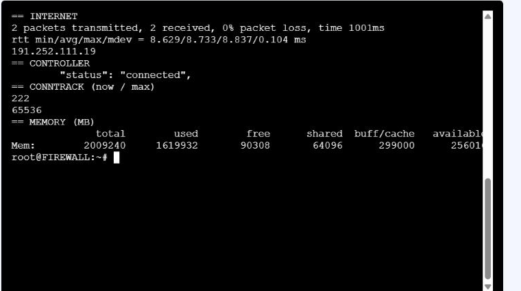

# KBA-0001: Verificação de saúde em 5 minutos

**Sintoma.** Algo está errado e você não sabe por onde começar, ou quer confirmar que a unidade está saudável após uma mudança.

**Aplica-se a.** Nexwall Firewall 26.2.1. Somente leitura: nada aqui altera a configuração. Execute como `root` por SSH, console ou terminal remoto do controlador.

## Execute

Cole o bloco inteiro. Leva cerca de cinco segundos.

```sh
echo "== TIME"; date; uptime
echo "== DISK"; df -h / /mnt/data 2>/dev/null
echo "== MEMORY (MB)"; free -m | head -2
echo "== LINKS"; ip -br a
echo "== DEFAULT ROUTE"; ip route | grep default
echo "== INTERNET"; ping -c2 -W2 8.8.8.8 | tail -2
echo "== DNS"; dig +short +time=3 +tries=1 nexwall.com.br
echo "== CONTROLLER"; ubus call ns.plug status | grep '"status"'
echo "== CONNTRACK (now / max)"; conntrack -C; cat /proc/sys/net/netfilter/nf_conntrack_max
echo "== CRITICAL ERRORS"; grep -iE 'out of memory|oom|segfault|panic' /var/log/messages | tail -3
```

Exemplo de saída de uma unidade saudável:



## Como ler o resultado

| Seção | Saudável | Se não |
|---|---|---|
| `DISK` | `/` abaixo de 85% usado | Limpe logs e backups antigos; veja [Logs](../operation-analytics/logs.md). Disco cheio para serviços. |
| `MEMORY` | `available` é mais de 10% de `total` | Vazamento ou recursos demais em unidade pequena. Veja [Desempenho](../operation-analytics/performance.md). |
| `LINKS` | WAN e LAN `UP` com endereço | WAN sem endereço: vá para [KBA-0003](kba-03-no-internet.md). |
| `DEFAULT ROUTE` | Uma linha `default via` por WAN | Ausente: a WAN não recebeu gateway. [KBA-0003](kba-03-no-internet.md). |
| `INTERNET` | 0% de perda | Perda ou sem resposta: [KBA-0003](kba-03-no-internet.md). |
| `DNS` | Um endereço IP é impresso | Vazio: [KBA-0005](kba-05-dns.md). |
| `CONTROLLER` | `"status": "connected"` | Desconectado: [Registro no controlador](controller-registration-troubleshooting.md). |
| `CONNTRACK` | "now" bem abaixo de "max" | Perto do máximo: um cliente está inundando conexões; localize em [Conexões](../operation-analytics/monitor-connections.md). |
| `CRITICAL ERRORS` | Nada é impresso | Leia as linhas e envie com o [pacote de suporte](kba-17-support-package.md). |

## Próximo passo

Tudo saudável e o problema continua? Provavelmente é um serviço ou um destino específico: use [KBA-0016](kba-16-services.md). Em dúvida? Colete o [pacote de suporte (KBA-0017)](kba-17-support-package.md).
