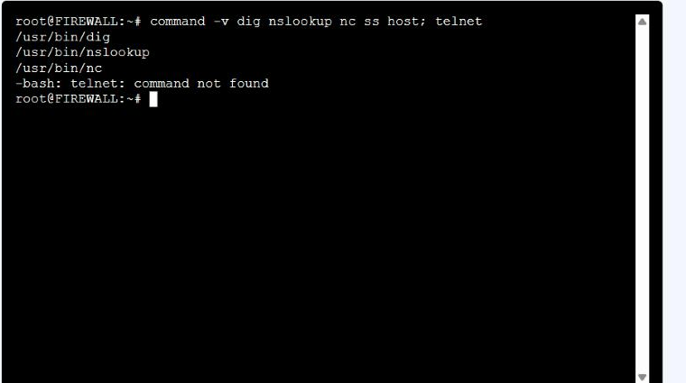
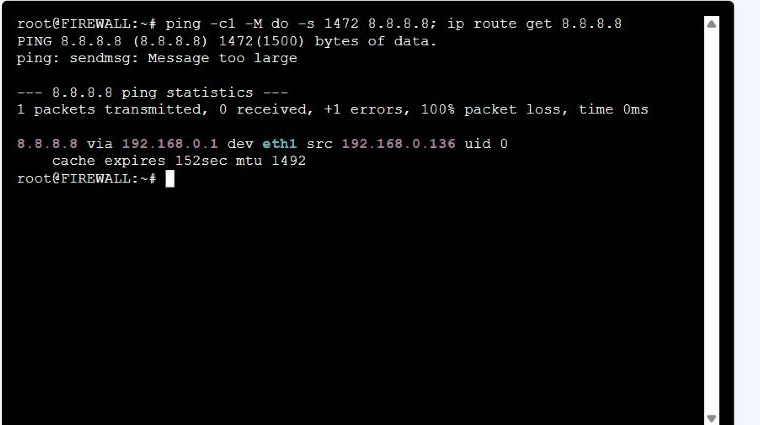
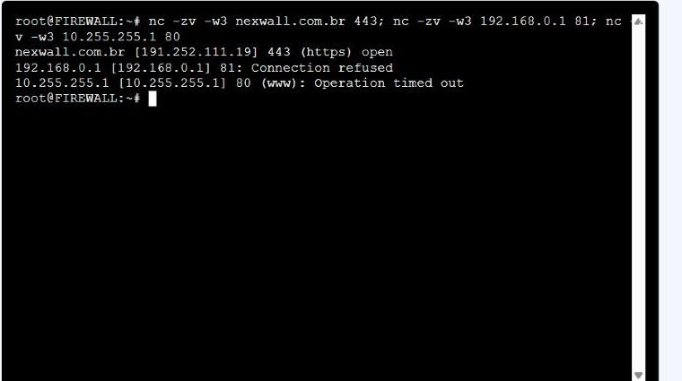
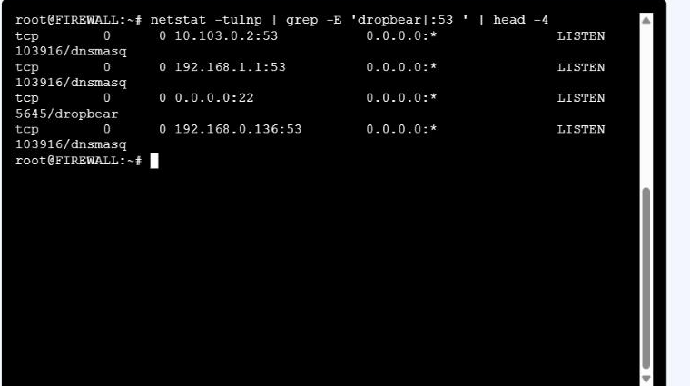

# KBA-0014: Testar conectividade, portas e tráfego pela linha de comando

**Sintoma.** Um usuário não alcança um servidor, um serviço publicado não responde, ou uma VPN está lenta ou perde
pacotes grandes.

**Aplica-se a.** Nexwall Firewall 26.2.1. Os comandos rodam como `root` por SSH, pelo console ou pelo
[terminal do controller](../administration/central-management.md).

## Ferramentas que não estão instaladas

Esta imagem é pequena de propósito. Algumas ferramentas conhecidas não existem; use o substituto.

| Falta | Use no lugar |
|---|---|
| `telnet` | `nc -zv <host> <porta>` para testar uma porta, ou `nc <host> <porta>` para abrir uma conexão direta e conversar com ela |
| `ss` | `netstat -tulnp` (portas em escuta e o processo de cada uma) |
| `host` | `dig` ou `nslookup` (veja a [KBA de DNS](kba-15-dns-deep-dive.md)) |
| `mtr` | `traceroute -n <host>` |

Instaladas e prontas: `ping` (a versão completa, com `-M do -s`), `traceroute`, `nc`, `curl`, `wget`, `openssl`,
`tcpdump`, `netstat`, `lsof`, `fuser`, `conntrack`, `arping`, `arp-scan`, `ethtool`, `bwm-ng`, `dig`, `nslookup`.

O `speedtest` (SpeedTest++, um teste de velocidade da WAN: download, upload e latência) também vem instalado. `iperf3` e `nmap` não fazem parte da imagem, e você não precisa instalar nada para seguir este artigo.



*Captura: dig, nslookup e nc estão instalados; telnet, ss e host não.*


## 1. Link e endereços

```bash
ip -br a
ip route
```

```text
eth1       UP    192.168.0.136/24
br-lan     UP    192.168.1.1/24
tun-nsplug UNKNOWN 10.103.0.2/16

default via 192.168.0.1 dev eth1 proto static src 192.168.0.136 metric 20
192.168.1.0/24 dev br-lan proto kernel scope link src 192.168.1.1
```

Confira se a interface está `UP` e tem o endereço esperado, e se existe uma rota `default`. Uma interface de túnel
como `tun-nsplug` (o link com o controller) mostra `UNKNOWN`, o que é normal em túneis.
Se desconfiar do link físico, `ethtool <interface>` mostra a velocidade e se o link foi detectado.

## 2. Alcance e caminho

```bash
ping -c3 8.8.8.8
```

```text
3 packets transmitted, 3 received, 0% packet loss, time 2004ms
rtt min/avg/max/mdev = 10.256/11.931/12.869/1.187 ms
```

```bash
traceroute -n -m5 -w1 8.8.8.8
```

```text
 1  192.168.0.1  3.870 ms  3.572 ms  5.708 ms
 2  *  *  *
 3  ...
```

`* * *` em um salto é comum: muitos roteadores não respondem às sondas. O que importa é se os saltos seguintes
respondem. Se o rastreio para no primeiro salto, o problema é o próximo equipamento ou o link. Para confirmar quem
está no segmento local use `ip neigh`, ou `arping -I eth1 <ip>`.

## 3. MTU: o pacote grande demais

Pacotes grandes que somem enquanto os pequenos passam são o sintoma clássico de MTU, mais comum em VPNs e links PPPoE.
Envie um pacote que não pode ser fragmentado:

```bash
ping -c1 -M do -s 1472 8.8.8.8
```

```text
PING 8.8.8.8 (8.8.8.8) 1472(1500) bytes of data.
ping: sendmsg: Message too large
```

`1472` mais 28 bytes de cabeçalhos dá 1500. "Message too large" aqui significa que o caminho até esse destino permite
menos. Pergunte ao kernel o que ele aprendeu:

```bash
ip route get 8.8.8.8
```

```text
8.8.8.8 via 192.168.0.1 dev eth1 src 192.168.0.136 uid 0
    cache expires 571sec mtu 1492
```



*Captura: um pacote de 1500 bytes que não cabe e a MTU de caminho de 1492 aprendida pelo kernel.*


A MTU do caminho é **1492**, típica de um link PPPoE. Um tamanho menor passa:

```bash
ping -c1 -M do -s 1400 8.8.8.8
```

Diminua o tamanho passo a passo até passar; o maior tamanho que passa mais 28 é a MTU utilizável. Da mesma forma, o
link com o controller registra o valor que lhe foi informado: `grep Path-MTU /var/log/messages | tail -3` mostra
linhas como `EMSGSIZE Path-MTU=1420`.

## 4. A porta está aberta? (substituindo o telnet)

```bash
nc -zv -w3 nexwall.com.br 443
```

```text
nexwall.com.br [191.252.111.19] 443 (https) open
```

Os três resultados possíveis indicam onde olhar:

| Resultado | Significado | Onde olhar |
|---|---|---|
| `open` | Algo respondeu | O caminho de rede está bem, olhe a aplicação |
| `Connection refused` | O destino respondeu que nada escuta | O serviço está parado, ou em outra porta |
| `Operation timed out` | Nenhuma resposta | Uma regra de firewall, uma rota ausente ou um equipamento fora do ar está descartando o tráfego |

```bash
nc -zv -w3 192.168.0.1 81
nc -zv -w3 10.255.255.1 80
```

```text
192.168.0.1 [192.168.0.1] 81: Connection refused
10.255.255.1 [10.255.255.1] 80 (www): Operation timed out
```



*Captura: os três resultados do nc -zv: open, Connection refused e Operation timed out.*


Para checar um serviço web de ponta a ponta, e um certificado:

```bash
curl -sI --max-time 6 https://nexwall.com.br | head -3
echo | openssl s_client -connect nexwall.com.br:443 -servername nexwall.com.br 2>/dev/null | grep -E "subject=|issuer=|Verify return|Protocol"
```

```text
HTTP/1.1 200 OK
subject=CN=nexwall.com.br
issuer=C=US, O=Let's Encrypt, CN=YE1
Protocol: TLSv1.3
Verify return code: 0 (ok)
```

## 5. O que está escutando no firewall?

```bash
netstat -tulnp
```

```text
Proto Local Address          State    PID/Program name
tcp   0.0.0.0:443            LISTEN   52552/uci.conf
tcp   0.0.0.0:22             LISTEN   5645/dropbear
tcp   192.168.1.1:53         LISTEN   103916/dnsmasq
udp   192.168.1.1:53                  103916/dnsmasq
```



*Captura: netstat -tulnp mostrando o dropbear na porta 22 e o dnsmasq na 53.*


Use para confirmar que um serviço está ligado à interface esperada (`127.0.0.1` significa só local, `0.0.0.0`
significa todas as interfaces). Para ver quem ocupa uma porta, `lsof -i :443`.

## 6. Observe os pacotes

```bash
tcpdump -i eth1 -n -c 6 'udp port 53 or icmp'
```

```text
19:44:29.645520 IP 8.8.8.8 > 192.168.0.136: ICMP echo reply, id 37053, seq 1, length 64
19:44:30.003115 IP 192.168.0.136 > 1.1.1.1: ICMP echo request, id 37056, seq 1, length 24
```

Capture no lado LAN e no lado WAN do mesmo fluxo: o endereço de origem (e muitas vezes a porta) deve ser diferente,
o que prova que o NAT está funcionando. Acrescente `-w /tmp/capture.pcap` para salvar um arquivo para o Wireshark, e
sempre limite a captura com um filtro ou `-c`, porque o `/tmp` fica na memória e uma captura longa o enche.

## 7. A conexão está sendo rastreada?

```bash
conntrack -C
conntrack -L -d 8.8.8.8 | head -3
```

```text
381
udp 17 10 src=192.168.0.136 dst=8.8.8.8 sport=40102 dport=53 ... src=8.8.8.8 dst=192.168.0.136 sport=53 dport=40102 ...
udp 17 40 src=192.168.0.136 dst=8.8.8.8 sport=49943 dport=33440 ... [UNREPLIED] ...
```

O primeiro número é a quantidade de conexões rastreadas. Uma entrada marcada **`[UNREPLIED]`** saiu do firewall e
ainda não recebeu resposta. Se todas as tentativas para um destino ficam em `UNREPLIED`, o problema está além do
firewall. Se a conexão não aparece, ela foi descartada antes do rastreamento: confira as regras do firewall e o log.

## Referência rápida

| Pergunta | Comando |
|---|---|
| A interface está ativa, com qual endereço? | `ip -br a` |
| Existe rota padrão? | `ip route` |
| Por onde sairia o tráfego para X? | `ip route get <ip>` |
| X está vivo? | `ping -c3 <ip>` |
| Onde o caminho para? | `traceroute -n <ip>` |
| A porta está aberta? | `nc -zv -w3 <host> <porta>` |
| O que escuta aqui? | `netstat -tulnp` |
| Como estão os pacotes? | `tcpdump -i <if> -n host <ip>` |
| Está rastreada e com NAT? | `conntrack -L -d <ip>` |
| Velocidade da WAN (download, upload, latência) | `speedtest` |

## Páginas relacionadas

- [KBA: Solucionar problemas de DNS pela linha de comando](kba-15-dns-deep-dive.md)
- [KBA: Verificar e solucionar problemas de serviços pela linha de comando](kba-16-services.md)
- [Ferramentas de solução de problemas de rede](network-troubleshooting-tools.md)
- [Monitoramento de conexões](../operation-analytics/monitor-connections.md)
