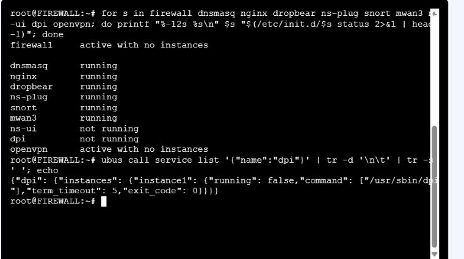

# KBA-16: Verificar e solucionar problemas de serviços pela linha de comando

**Sintoma.** Um recurso do firewall (DNS, VPN, IPS, proteção web, o link com o controller) não se comporta bem e a
interface web não diz por quê.

**Aplica-se a.** Nexwall Firewall 26.2.1. Os comandos rodam como `root` por SSH, pelo console ou pelo
[terminal do controller](../administration/central-management.md). Qual serviço sustenta cada recurso está na
[Referência de comandos de serviços e logs](service-and-log-reference.md).

## 1. Pergunte ao serviço o status dele

```bash
/etc/init.d/dnsmasq status
```

```text
running
```

Confira vários de uma vez:

```bash
for s in firewall dnsmasq nginx dropbear ns-plug snort mwan3 ns-ui dpi openvpn; do
  printf "%-12s %s\n" $s "$(/etc/init.d/$s status 2>&1 | head -1)"
done
```

```text
firewall     active with no instances
dnsmasq      running
nginx        running
dropbear     running
ns-plug      running
snort        running
mwan3        running
ns-ui        not running
dpi          not running
openvpn      active with no instances
```

## 2. Como ler a resposta

`not running` **nem sempre é uma falha**. A palavra depende de como o serviço é construído:

| Resposta | Significado | Falha? |
|---|---|---|
| `running` | Um processo de longa duração está ativo | Não |
| `active with no instances` | O serviço está habilitado mas não tem nada para executar, por exemplo `openvpn` sem túnel configurado, ou `firewall`, que apenas carrega regras | Não, a menos que você tenha configurado algo que dependa dele |
| `not running` | Nenhum processo está ativo agora | **Depende**: um serviço que deveria ficar no ar está parado (falha), ou é um serviço *de execução única* que cumpriu a tarefa e saiu (normal) |

`ns-ui`, `dpi` e `ns-binding` são serviços de execução única nesta versão. Comprove pedindo os detalhes ao gerenciador
de serviços:

```bash
ubus call service list '{"name":"dpi"}'
```

```text
{ "dpi": { "instances": { "instance1": { "running": false, "command": [ "/usr/sbin/dpi" ], "exit_code": 0 } } } }
```



*Captura: status de dez serviços; ns-ui e dpi dizem "not running" mas terminaram normalmente (exit_code 0).*


`"running": false` com `"exit_code": 0` significa que o programa terminou normalmente. Uma falha real mostra um
`exit_code` diferente de zero, ou uma instância que reinicia sem parar. Confirme sempre pelo **efeito**: uma interface
web que abre, ou um bloqueio de DPI no log, dizem mais que a palavra "running".

Para um serviço em execução, a mesma chamada devolve o `pid` e a linha de comando exata, que mostra qual arquivo de
configuração ele lê:

```bash
/etc/init.d/dnsmasq info
```

## 3. Está habilitado na inicialização?

```bash
/etc/init.d/dnsmasq enabled && echo yes || echo no
```

Um serviço que funciona ao iniciá-lo manualmente e some depois de um reinício não está habilitado. Use
`/etc/init.d/<serviço> enable`.

## 4. Está escutando e responde?

```bash
netstat -tulnp | grep -E 'dnsmasq|dropbear|nginx'
```

```text
tcp   0.0.0.0:22         LISTEN   5645/dropbear
tcp   192.168.1.1:53     LISTEN   103916/dnsmasq
```

Depois teste o serviço pela rede, como um cliente faria: `nc -zv -w3 <ip> <porta>` ou `dig @<ip> <nome>`. Veja a
[KBA de conectividade](kba-14-connectivity.md).

## 5. Leia o log

Todos os serviços registram em `/var/log/messages`, cada um com o próprio nome (a coluna `Find it in the log` da
[referência de serviços](service-and-log-reference.md)).

```bash
grep -i ns-plug /var/log/messages | tail -5
tail -f /var/log/messages | grep -i dnsmasq
```

A mesma busca está disponível como uma única chamada `ubus`, que é a que a página **Logs** da interface web usa:

```bash
ubus call ns.log get-log '{"search":"dropbear","limit":2}'
```

```text
{ "values": [
    "Nov 19 19:45:08 FIREWALL.lan dropbear[102974]: Child connection from 192.168.0.8:52414",
    "Nov 19 19:45:08 FIREWALL.lan dropbear[102974]: Password auth succeeded for 'root' from 192.168.0.8:52414" ] }
```

Leia as linhas **em volta do momento da falha**. Mensagens como `EMSGSIZE Path-MTU=1420`, `refused`,
`timed out`, `failed` e `cannot` são as primeiras a observar. Esta unidade não tem `logread`; veja
[Logs e depuração](cli-logs-and-debugging.md).

## 6. Confira a configuração antes de reiniciar

Reiniciar com a configuração quebrada transforma um problema pequeno em uma parada. Valide antes, onde o serviço
permitir:

| Serviço | Verificação |
|---|---|
| `dnsmasq` | `dnsmasq --test` imprime `syntax check OK.` |
| IPS (`snort`) | `snort-mgr check` valida a configuração gerada sem aplicá-la |
| Qualquer ajuste UCI | `uci show <config>` mostra o que o serviço vai ler; veja [Entendendo o UCI](understanding-uci.md) |

## 7. Reiniciar ou recarregar

```bash
/etc/init.d/firewall reload     # aplica regras sem derrubar conexões
/etc/init.d/dnsmasq restart     # breve interrupção
```

Tente `reload` primeiro onde existir. O `restart` interrompe o serviço por um instante, então numa unidade em produção
faça quando for aceitável. Não reinicie o `keepalived` diretamente em um par de alta disponibilidade; use o
`ns-ha-config`. Depois repita os passos 1 e 4 e leia o log de novo.

## 8. Status específico de cada recurso

Quando as verificações genéricas passam e o recurso continua com problema, o recurso tem o próprio comando de status:

| Recurso | Comando |
|---|---|
| Link com o controller | `ubus call ns.plug status` |
| SD-WAN | `mwan3 status` |
| WireGuard | `wg show` |
| IPsec | `swanctl --list-sas` |
| IPS | `snort-mgr status` |
| Alta disponibilidade | `ns-ha-config status` |

```bash
ubus call ns.plug status
```

```text
{
	"status": "connected",
	"address": "10.103.0.2",
	"server": "https://cloud.nexwall.com.br",
	"unit_name": "Nexwall-LAB-FW"
}
```

## 9. Pouca memória é uma causa oculta frequente

O sistema para serviços quando a memória acaba, e os recursos de filtragem (IPS, filtragem de DNS, proteção web) são os
que mais consomem.

```bash
free
snort-mgr status
```

```text
              total        used        free      shared  buff/cache   available
Mem:        2009240     1254832      184416       68744      569992      612240
Total system memory=1962.148M  Used=1786.797M (91.1%)  Free=175.352M (8.9%)
```

Os valores estão em kilobytes. Se `available` estiver muito baixo, ou serviços reiniciarem sem motivo aparente,
procure linhas de memória esgotada com `grep -i "out of memory\|oom" /var/log/messages | tail` e considere desligar as
listas ou recursos de que não precisa. A página de filtragem de DNS mostra quanta memória as listas ativas exigem.

## Referência rápida

| Pergunta | Comando |
|---|---|
| Está rodando? | `/etc/init.d/<svc> status` |
| De verdade? Código de saída, pid, comando | `ubus call service list '{"name":"<svc>"}'` |
| Habilitado na inicialização? | `/etc/init.d/<svc> enabled` |
| Está escutando? | `netstat -tulnp \| grep <svc>` |
| O que diz o log? | `grep -i <svc> /var/log/messages \| tail -20` |
| Reiniciar | `/etc/init.d/<svc> restart` |
| Todos os serviços desta unidade | `ls /etc/init.d` |

## Páginas relacionadas

- [KBA: Solucionar problemas de DNS pela linha de comando](kba-15-dns-deep-dive.md)
- [KBA: Testar conectividade, portas e tráfego pela linha de comando](kba-14-connectivity.md)
- [Referência de comandos de serviços e logs](service-and-log-reference.md)
- [Logs e depuração pela linha de comando](cli-logs-and-debugging.md)
