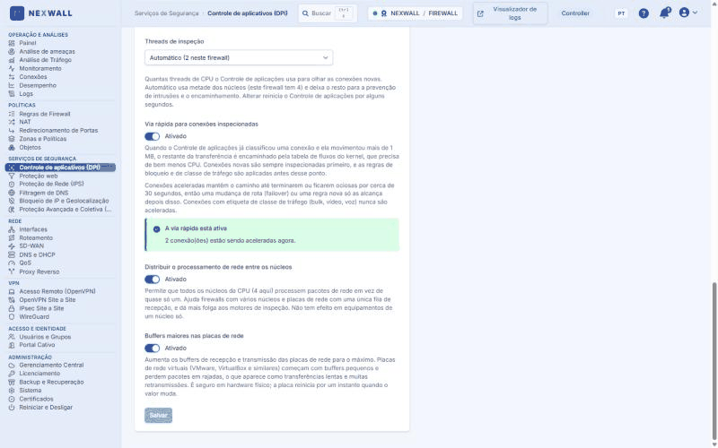
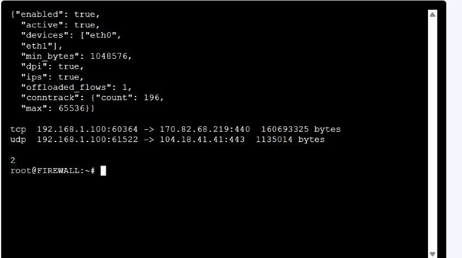

# KBA-0018: Fast path (flow offload): comandos, status e solução de problemas

**Aplica-se a.** Nexwall Firewall 26.2.1 (comandos verificados nesta versão).

## O que é

Os dois motores de inspeção olham apenas o início de uma conexão: o DPI os primeiros 32 pacotes, o IPS até sua profundidade de inspeção (1 MiB por padrão). Depois disso, o resto de uma transferência longa só precisa ser encaminhado. O **fast path** entrega essas conexões à tabela de fluxos por software do kernel, que encaminha seus pacotes sem percorrer de novo roteamento, NAT e os hooks do firewall. Usa muito menos CPU em downloads longos, backups e vídeo, e deixa mais folga para as assinaturas.

**Não** é a chave padrão "Software flow offloading": essa descarrega todas as conexões logo após o handshake e esconderia o início de cada conexão do DPI e do IPS. O fast path da Nexwall descarrega uma conexão somente quando

- ela está estabelecida, transportou mais que o limite (a profundidade de inspeção do IPS enquanto o IPS roda, no mínimo 256 KiB, e mais de 32 pacotes), e
- quando o DPI roda: o motor a marcou como `netify-analyzed`, ela não tem rótulo de classe de tráfego (`bulk`, `best_effort`, `video`, `voice`) e não está `netify-blocked`.

Tudo vive em sua própria tabela nftables, `inet nexwall_fastpath`. Removê-la devolve todas as conexões ao caminho normal. Qualquer erro também deixa o tráfego no caminho normal.

## Ligar ou desligar


*Controle de aplicações > Configurações: opções de desempenho*

Interface: **Controle de aplicações (DPI) > Configurações > Desempenho** ou **Proteção de rede (IPS) > Configurações > Desempenho** (uma única chave para ambos); depois Salvar e aplicar as alterações pendentes.

Linha de comando:

```sh
uci set nexwall_perf.main.fastpath=1      # 0 para desligar
uci commit nexwall_perf
/etc/init.d/nexwall-fastpath reload       # aplica agora (também acontece no próximo reload de configuração)
```

Configuração relacionada, tratada pela mesma ferramenta: `nexwall_perf.main.ring_buffers` (`1` sobe os anéis da placa de rede ao máximo ao aplicar, independente do fast path; veja [KBA-0019](kba-19-inspection-settings.md)).

Opcional: `uci set nexwall_perf.main.min_bytes=2097152` sobe o limite (padrão `auto`; valores abaixo de 262144 são elevados a esse valor).

## Comandos


*Saída de nexwall-fastpath status e list*

| Comando | O que faz |
|---|---|
| `nexwall-fastpath status` | Uma linha JSON: `enabled`, `active`, `devices`, `min_bytes`, `dpi`, `ips`, `offloaded_flows`, e `reason`/`error` quando não está ativo |
| `nexwall-fastpath list` | As conexões que estão no fast path agora, as maiores primeiro: protocolo, origem, destino, bytes |
| `nexwall-fastpath apply` | Lê as configurações e (re)cria a tabela; também esvazia a tabela de fluxos, então cada conexão é avaliada de novo com as regras atuais |
| `nexwall-fastpath stop` | Remove a tabela imediatamente (a configuração continua como está) |
| `/etc/init.d/nexwall-fastpath start \| reload \| stop` | O mesmo pelo serviço; reaplica ao mudar `nexwall_perf`, `dpi`, `snort`, `network` e ao subir ou descer interfaces |

Exemplo:

```sh
# nexwall-fastpath status
{"enabled": true, "active": true, "devices": ["eth0", "eth1"], "min_bytes": 1048576, "dpi": true, "ips": true, "offloaded_flows": 3}

# nexwall-fastpath list
tcp  192.168.1.242:3350 -> 162.159.140.220:443  103919398 bytes
```

## Onde ver o tráfego descarregado

- **Interface:** o cartão Desempenho mostra "Fast path ativo" e quantas conexões estão aceleradas (atualiza a cada 15 s).
- **Rastreamento de conexões:** conexões aceleradas têm a marca `[OFFLOAD]` e seus contadores de bytes continuam contando:

```sh
grep OFFLOAD /proc/net/nf_conntrack
conntrack -L 2>/dev/null | grep OFFLOAD
```

- **Regras e contadores:** `nft list table inet nexwall_fastpath` (dispositivos da tabela de fluxos, regras de rótulo, regra de descarga).
- **Log do sistema:** cada aplicação, parada e falha é registrada com a tag `nexwall-fastpath`:

```sh
grep nexwall-fastpath /var/log/messages
```

## Lendo o `status`

| `reason` | Significado | O que fazer |
|---|---|---|
| `disabled` | A chave está desligada | Nada, ou ligue |
| `not-applied` | A configuração está ligada mas nada foi aplicado ainda | `/etc/init.d/nexwall-fastpath start` (registra os gatilhos) e depois `reload` |
| `no-devices` | Nenhuma interface ativa foi encontrada para a tabela de fluxos | Verifique `ubus call network.interface dump`; corrija a interface e rode `nexwall-fastpath apply` |
| `error` | O `nft` recusou o conjunto de regras (`error` traz a mensagem) | Verifique os módulos do kernel `nf_flow_table`, `nft_flow_offload`; envie a mensagem ao suporte |

`offloaded_flows` igual a 0 com a chave ligada é normal até que uma conexão passe do limite **e** o DPI a tenha analisado. Uma página web curta nunca chega ao fast path.

## Bom saber

- Uma conexão acelerada mantém seu caminho até terminar ou ficar ociosa por cerca de 30 segundos. Uma mudança de rota (failover de WAN) ou uma nova regra de firewall/DPI só chega a ela depois disso. `nexwall-fastpath apply` (também executado após cada reload do DPI) esvazia a tabela de fluxos para que tudo seja avaliado de novo.
- Conexões com rótulo de classe de tráfego (bulk, vídeo, voz das regras de QoS do DPI) nunca são aceleradas, porque a marcação DSCP é feita por um hook que pacotes descarregados pulam.
- A tabela de fluxos tem a opção `counter`: os contadores de bytes e pacotes das conexões aceleradas continuam atualizados, então estatísticas e contabilização de tráfego seguem funcionando. (Sem ela os contadores congelariam no ponto da descarga.)
- Túneis (OpenVPN, WireGuard, IPsec) não entram na tabela de fluxos; seu tráfego não é acelerado.
- O SQM / controle de tráfego na interface continua valendo (atua na disciplina de fila, depois do encaminhamento).
- Em testes de laboratório (firewall virtual) o fast path deu cerca de 10% a mais de vazão e cerca de 10% menos CPU por Gbit/s; os maiores ganhos vieram da distribuição de pacotes entre núcleos e de buffers de rede maiores. Veja [KBA-0020](kba-20-throughput-sizing.md). Meça no seu hardware.

## Verificações rápidas quando algo parece errado

```sh
nexwall-fastpath status
nft list table inet nexwall_fastpath | head -30
grep -c OFFLOAD /proc/net/nf_conntrack
grep nexwall-fastpath /var/log/messages | tail
/etc/init.d/nexwall-fastpath status
```

Para descartar o fast path como causa de um problema, desligue e teste de novo:

```sh
uci set nexwall_perf.main.fastpath=0; uci commit nexwall_perf; nexwall-fastpath stop
```

## O que coletar antes de contatar o suporte

1. `nexwall-fastpath status`, `nexwall-fastpath list | head`, `nft list table inet nexwall_fastpath`.
2. `grep nexwall-fastpath /var/log/messages`.
3. `uci show nexwall_perf; uci show dpi.engine; uci show snort.nfq`.
4. Os endereços do cliente e do servidor afetados e o horário, para achar a conexão em `nexwall-fastpath list`.
