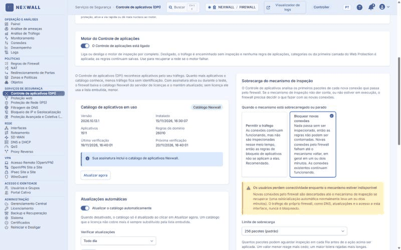
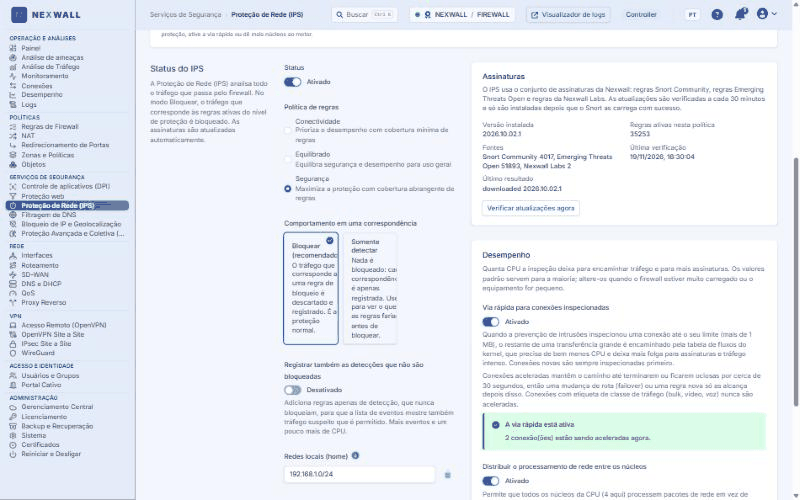
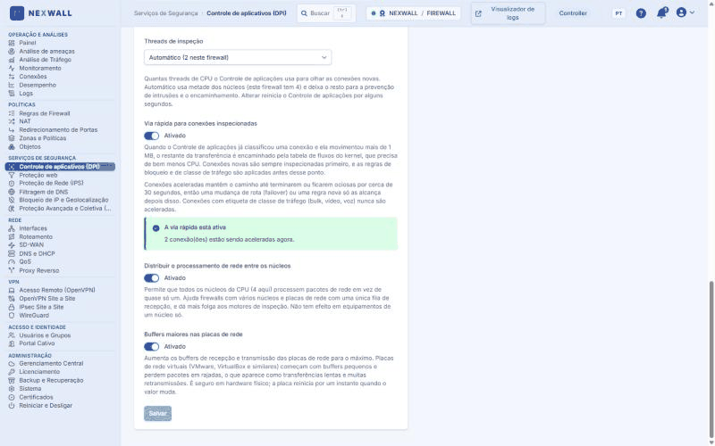
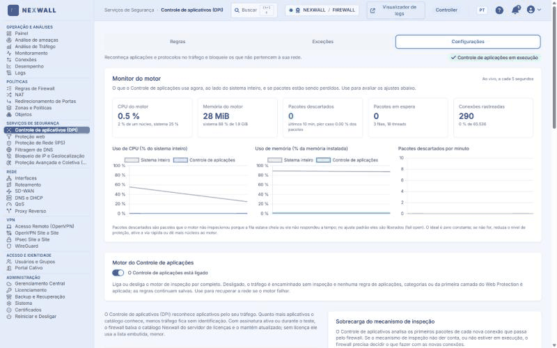

# KBA-0019: Configurações de inspeção: Controle de aplicações (DPI) e IPS

Os dois motores leem pacotes de filas do kernel e dividem a CPU com o encaminhamento. Estes controles decidem quanta CPU usam, o que acontece quando não dão conta e como o IPS reage a uma correspondência. Os padrões servem para a maioria dos firewalls. Cada configuração da interface é salva como alteração pendente: pressione **Aplicar alterações** depois.

**Aplica-se a.** Nexwall Firewall 26.2.1. Para dimensionar e medir veja [KBA-0020](kba-20-throughput-sizing.md).

## Onde fica cada configuração

| Configuração | Local na interface | UCI / comando |
|---|---|---|
| Threads de inspeção do DPI | Controle de aplicações (DPI) > Configurações > Desempenho | `dpi.engine.threads` (`auto`, `1`..`4`) |
| Comportamento de sobrecarga do DPI | Controle de aplicações (DPI) > Configurações > Sobrecarga do motor de inspeção | `dpi.engine.overload_action` (`allow`, `block`) |
| Limite de fila do DPI | mesmo cartão | `dpi.engine.queue_limit` (`128`, `256`, `512`, `1024`) |
| Fast path | DPI > Configurações > Desempenho e IPS > Configurações > Desempenho (mesma chave) | `nexwall_perf.main.fastpath` (`0`, `1`) |
| Distribuir o processamento de rede entre núcleos | os mesmos dois cartões (mesma chave) | `network.@globals[0].packet_steering` (`0`, `1`) |
| Buffers maiores da placa de rede | os mesmos dois cartões (mesma chave) | `nexwall_perf.main.ring_buffers` (`0`, `1`) |
| IPS ligado/desligado, nível de proteção | Proteção de rede (IPS) > Configurações | `snort.snort.enabled`, `snort.snort.ns_policy` (`connectivity`, `balanced`, `security`) |
| Comportamento em uma correspondência | IPS > Configurações | `snort.snort.action` (`default` = Bloquear, `alert` = Apenas detectar) |
| Registrar também detecções não bloqueadas | IPS > Configurações | `snort.snort.ns_alert_excluded` (`0`, `1`) |
| Profundidade de inspeção do IPS | sem interface (API/UCI) | `snort.nfq.max_inspect_bytes` (bytes, padrão `1048576`, `0` = ilimitado) |
| Redes protegidas (HOME_NET) | IPS > Configurações | `snort.snort.home_net` |
| Assinaturas | IPS > Configurações > Assinaturas | `nexwall-ips-rules status \| update \| apply` |

## Controle de aplicações (DPI)


*Controle de aplicações > Configurações: sobrecarga do motor de inspeção*

**Threads de inspeção.** Quantas instâncias de captura (uma thread cada, mais uma thread de detecção) olham as conexões novas. *Automático* usa metade dos núcleos, de 1 a 4, e 1 para o tráfego do próprio firewall (2 a partir de 8 núcleos): um equipamento de 2 núcleos recebe 1, um de 4 recebe 2, um de 8 recebe 4. O DPI só precisa dos primeiros 32 pacotes de uma conexão, por isso usa bem menos CPU que o IPS. Mais threads que núcleos só fazem os motores competirem. Mudar o valor reinicia o Controle de aplicações por alguns segundos (o número de instâncias é criado na partida).

**Quando o motor está sobrecarregado ou parado.** *Permitir o tráfego* (padrão, recomendado): se o motor não dá conta ou não está rodando, as conexões continuam funcionando mas não são inspecionadas, então as regras de aplicação não se aplicam a elas. *Bloquear conexões novas*: nada passa sem inspeção; conexões novas falham até o motor voltar (normalmente um ou dois minutos); as existentes continuam funcionando. O tráfego do próprio firewall sempre falha aberto.

**Limite de fila.** Pacotes que podem esperar por fila (128 a 1024). Maior absorve rajadas e acrescenta latência; menor cai mais cedo no comportamento de sobrecarga. Mantenha 256 a menos que veja descartes.

## Proteção de rede (IPS)


*Proteção de rede (IPS) > Configurações: nível de proteção, comportamento em uma correspondência e desempenho*

**Nível de proteção.** *Conectividade* bloqueia só ameaças críticas de alta confiança (menos falsos positivos, menor conjunto de regras, menos CPU). *Equilibrado* acrescenta ameaças importantes de alta confiança. *Segurança* acrescenta regras de confiança média e varreduras/DoS (mais proteção, mais falsos positivos, mais CPU). Regras de bloqueio aproximadas no pacote atual: 3.900 / 22.600 / 35.200.

**Comportamento em uma correspondência.**
- *Bloquear (recomendado, padrão)*: o tráfego que casa com uma regra de **bloqueio** do nível escolhido é descartado e registrado como `Drop`.
- *Apenas detectar*: nada é bloqueado, cada correspondência é só registrada como `Alert`. Use para ver o que as regras fariam antes de bloquear. Um aviso é exibido enquanto estiver ativo; volte para Bloquear ao terminar.

**Registrar também detecções não bloqueadas.** Acrescenta regras somente de detecção (cerca de 7.600, nunca bloqueiam) para que Eventos de hoje mostre também tráfego suspeito permitido (`Alert`). Mais eventos e um pouco mais de CPU. Deixe desligado a menos que queira essa visibilidade. A regra de teste de alerta da Nexwall Labs (cabeçalho `X-Nexwall-IPS-Test: 1`) só aparece com isso ligado ou no modo Apenas detectar.

**Profundidade de inspeção (`snort.nfq.max_inspect_bytes`).** O IPS para de inspecionar uma conexão depois desta quantidade de bytes (nos dois sentidos) e deixa passar o resto. Menor = menos CPU, mas cargas tardias não são inspecionadas; `0` = sem limite (mais CPU). É também o ponto a partir do qual o fast path pode assumir.

**Assinaturas.** Entregues pelo serviço de assinaturas da Nexwall (regras Snort Community, Emerging Threats Open e Nexwall Labs), atualizadas diariamente no servidor e consultadas pelo firewall a cada 30 minutos. Um pacote novo é validado com o Snort antes do uso; se o Snort o rejeitar, as regras anteriores permanecem. Veja *IPS > Configurações > Assinaturas* ("Verificar atualizações agora").

## Compartilhado: fast path e distribuição de pacotes


*Controle de aplicações > Configurações: opções de desempenho*

**Fast path.** Encaminha o resto das transferências longas pela tabela de fluxos do kernel depois que os motores terminam com elas (detalhes, comandos e solução de problemas: [KBA-0018](kba-18-fast-path.md)). Ligado por padrão em instalações novas (só toca conexões que os motores já terminaram); desligue se precisar que todo pacote de conexões longas seja inspecionado ou que uma mudança de regra chegue de imediato às conexões existentes.

**Distribuir o processamento de rede entre núcleos (packet steering).** Deixa todos os núcleos processarem pacotes de rede em vez de quase só um. Ajuda firewalls com vários núcleos e placas de rede com **uma única fila de recepção** (placas virtuais, muitas placas pequenas); placas de servidor multifila já distribuem a carga. Sem efeito em equipamentos de um núcleo. Verifique o efeito com `cat /sys/class/net/<wan>/queues/rx-0/rps_cpus` (uma máscara com mais de um bit) e `top` (carga em vários núcleos).

**Buffers maiores da placa de rede (`ring_buffers`).** Eleva os anéis de recepção e transmissão das interfaces físicas ao máximo do hardware (`ethtool -G <if> rx max tx max`, aplicado no boot, em mudanças de interface e quando a configuração muda). Placas virtuais (e1000 no VMware, VirtualBox e similares) começam com 256 descritores e perdem pacotes em rajadas: TCP lento com milhares de retransmissões, perda de UDP. Verifique com `ethtool -g <if>` (atual vs máximo). Seguro em hardware físico. Ligado por padrão em instalações novas.

## Padrões em uma instalação nova

| Configuração | Padrão | Por quê |
|---|---|---|
| Threads de inspeção do DPI | Automático | metade dos núcleos, deixa o resto para o IPS e o encaminhamento |
| Nível de proteção do IPS | Equilibrado | medido em velocidade plena com os motores ligados; Conectividade só se o equipamento for muito pequeno |
| Comportamento do IPS | Bloquear | |
| Fast path | Ligado | só depois da inspeção; cerca de +10% de vazão e -10% de CPU no laboratório |
| Packet steering | Ligado quando há mais de um núcleo | placas de fila única ou virtuais foram de 100 a cerca de 700 Mbit/s |
| Buffers maiores da placa de rede | Ligado | placas virtuais perdem rajadas com os buffers pequenos padrão |

Unidades existentes mantêm o que têm; os padrões são criados apenas quando as configurações `nexwall_perf` ainda não existem.

## Voltar aos padrões

```sh
uci -q delete dpi.engine.threads
uci set dpi.engine.overload_action=allow; uci set dpi.engine.queue_limit=256
uci set nexwall_perf.main.fastpath=0
uci set network.@globals[0].packet_steering=0
uci set nexwall_perf.main.ring_buffers=0
uci set snort.snort.action=default; uci set snort.snort.ns_alert_excluded=0
uci set snort.nfq.max_inspect_bytes=1048576
uci commit; reload_config
```

## Monitor do motor


*Monitor do motor: CPU, memória, pacotes descartados e conexões rastreadas*

A aba Configurações do Controle de aplicações (DPI) e da Proteção de rede (IPS) começa com um **Monitor do motor** ao vivo (atualiza a cada 5 segundos): CPU do motor (percentual do sistema inteiro e de um núcleo) e do sistema, memória do motor e do sistema, **pacotes descartados** (pacotes que o motor não inspecionou porque sua fila estava cheia ou ele não respondeu; são liberados, falha aberta) como total de dez minutos, o pior percentual de tráfego e um gráfico por minuto, pacotes esperando nas filas e as conexões rastreadas frente ao limite. O objetivo é um zero constante em pacotes descartados. Os valores vêm de `ubus call ns.dpi get-engine-metrics` (igual para `ns.snort`).

## O que coletar antes de contatar o suporte

`uci show dpi.engine; uci show nexwall_perf; uci show snort | grep -v oinkcode`, `nexwall-fastpath status`, `nexwall-ips-rules status`, `dpidbg status`, `cat /proc/net/netfilter/nfnetlink_queue`, o número de núcleos de CPU (`grep -c ^processor /proc/cpuinfo`), e o horário e o sintoma (lento, descartes, bloqueio indevido).
