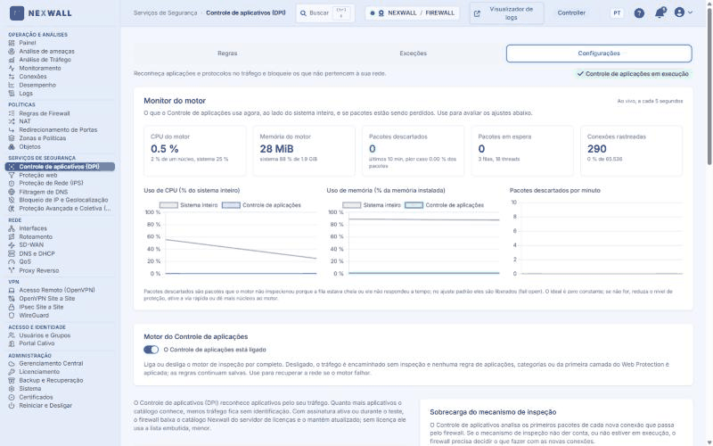

# KBA-0020: Vazão, CPU e memória: como medir e dimensionar

Use quando o firewall está lento sob inspeção, perde pacotes em rajadas ou você precisa dimensionar uma unidade nova. As configurações são explicadas no [KBA-0019](kba-19-inspection-settings.md).

**Aplica-se a.** Nexwall Firewall 26.2.1.

## Como verificar o efeito


*Monitor do motor: CPU, memória, pacotes descartados e conexões rastreadas*

```sh
dpidbg status                                    # filas do DPI: pacotes esperando e contadores de veredito
cat /proc/net/netfilter/nfnetlink_queue          # filas 50-5x DPI, 4-7 IPS: coluna 6 = descartados com a fila cheia
top -b -n1 | head -15                            # quem usa a CPU
nexwall-fastpath status                          # estado do fast path e conexões aceleradas
nexwall-ips-rules status                         # pacote de assinaturas, política, última verificação
ls /var/log/snort                                # alertas do IPS (JSON)
```

Colunas da fila: `queue_total` (esperando agora) deve ficar perto de 0; um `queue_dropped` crescente significa que o motor não dá conta: baixe o nível do IPS, ative o fast path ou dê mais núcleos aos motores.

## Pontos de partida por hardware

| Hardware | Threads DPI | Nível IPS | Fast path | Packet steering | Buffers maiores |
|---|---|---|---|---|---|
| 1-2 núcleos | Automático (1) | Conectividade | Ligado | Ligado (2 núcleos) | Ligado |
| 4 núcleos | Automático (2) | Equilibrado | Opcional (cerca de +10% em transferências longas no laboratório) | Ligado (placa de fila única ou virtual perde a maior parte da velocidade sem isso) | Ligado |
| 8+ núcleos | Automático (4) | Equilibrado ou Segurança | Ligado | Normalmente desnecessário em placas multifila | Ligado em placas virtuais |

São pontos de partida. Mude uma configuração por vez e compare.

## Tabela de conexões e memória

Cada conexão rastreada custa cerca de 5,6 KB (kernel, DPI e IPS juntos, medido com 77.000 conexões), por isso o limite de conexões é derivado da memória instalada: 32 entradas por MiB, no mínimo 65.536 (2 GiB: 65.536, 4 GiB: 131.072, 8 GiB: 253.952, 16 GiB: 524.288). O `nexwall-fastpath apply` o define no boot e no reload (`nexwall_perf.main.conntrack_auto=0` mantém um `net.netfilter.nf_conntrack_max` manual). O padrão do kernel (cerca de 1.000.000 de entradas com 8 GiB) deixaria os motores usarem mais memória do que um firewall pequeno tem: o firewall de laboratório parou de responder quando a tabela cresceu muito além do que cabia em seus 2 GiB. Acompanhe **Conexões rastreadas** no Monitor do motor; se ficar perto de 100 % o limite está baixo para o número de usuários e a resposta é mais memória, não uma tabela maior.

Filas e threads do IPS acompanham o número de núcleos de CPU (até 16) automaticamente (`snort.nfq.cpu_auto=0` mantém um valor manual); cada thread extra acrescenta cerca de 15 MB de memória.

## Medições de laboratório (firewall virtual, 4 vCPU, e1000)

VM cliente através do firewall até uma VM servidor, iperf3, 4 fluxos TCP, sentido reverso, 3 x 10 s por linha (Mbit/s, média):

| Configuração | Resultado |
|---|---|
| Direto entre as duas VMs (sem firewall) | cerca de 2.700 |
| Firewall, sem DPI/IPS, anéis padrão, sem steering | 17 a 120, milhares de retransmissões |
| igual, anéis no máximo | 100, uma retransmissão |
| anéis no máximo + packet steering | 694 |
| + DPI e IPS ligados (equilibrado) | 736 |
| + fast path | 740 a 890 (dois pares A/B: fast path 866 e 920 Mbit/s com 60 e 52 % de CPU por Gbit/s, desligado 840 e 758 com 60 e 65) |

Leitura: nesta placa virtual o primeiro limite foi o tamanho do anel (UDP a 300 Mbit/s perdeu 53% com 256 descritores, 0,3% com 4096), o segundo a interrupção única que mantinha um núcleo a 100% (o steering moveu a carga: de 100 a cerca de 700 Mbit/s). Com esses dois resolvidos, DPI e IPS custam pouco em transferências grandes, porque só inspecionam os primeiros 32 pacotes / 1 MiB de cada conexão, e o fast path deu cerca de 10% mais vazão com cerca de 10% menos CPU por Gbit/s (dentro do ruído de um host compartilhado). Muitas conexões pequenas (3.000 requisições HTTP curtas, 60 em paralelo): cerca de 155 requisições/s com DPI e IPS ligados contra 163 a 184 sem eles (o limite era o servidor de teste). Os números absolutos dependem do hipervisor; use-os para comparar configurações, não como especificações do produto.
