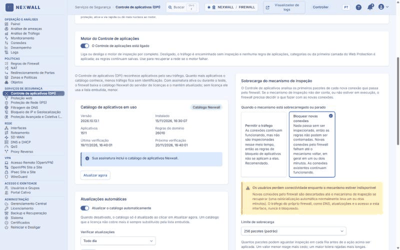

# KBA-21: Conexões novas travam mas o firewall parece saudável (fila DPI / IPS parada)

**Aplica-se a.** Nexwall Firewall 26.0.0 e posteriores (comandos verificados na 26.2.1). **Gravidade:** alta: conexões novas atrasadas ou falhando por minutos.

## Sintomas

- SSH ou a interface web não respondem pela WAN ou pela LAN, enquanto uma sessão **já aberta** continua funcionando (por exemplo, a interface web é alcançável em outra porta com uma conexão antiga).
- Usuários da LAN não conseguem abrir conexões novas (páginas novas, chamadas) enquanto downloads existentes continuam.
- Monitor > Fluxos ao vivo está **vazio** ou congelado.
- CPU e memória parecem normais (ociosidade acima de 95 %).
- Aparece a notificação "O motor de inspeção de tráfego parou de responder e foi recuperado" ou o log contém entradas do `nexwall-nfq-watchdog`.

## Causa

Os motores de inspeção leem pacotes de filas do kernel (NFQUEUE). Se um leitor deixa de ser atendido, ou fica lento demais, os pacotes esperam na fila e toda conexão cujos primeiros pacotes caem nessa fila trava. Conexões que já passaram dos primeiros 32 pacotes não são afetadas. A regra de firewall `queue flags bypass` não se aplica porque o programa ainda está rodando. (Um motor que caiu é diferente: falha aberto e o tráfego flui.)

## Verifique (2 minutos)

```sh
dpidbg status
```
Veja a tabela de filas: uma fila com muitos pacotes **esperando** e um contador de **vereditos** que não aumenta entre duas execuções está parada (filas 50-57 = DPI, 4-7 = IPS).

```sh
ls -lt /root/nfq-stall/ | head            # relatórios de diagnóstico, o mais novo primeiro
cat /root/nfq-stall/events.log            # histórico: hora, filas, serviço, ação
```

## Resolução

Automática: o watchdog (`nexwall-nfq-watchdog`, a cada minuto) reinicia o dono da fila parada, no máximo `max_restarts` vezes por hora. Espere recuperação em cerca de 2 minutos.

Manual, se o watchdog estiver desligado ou tiver atingido seu limite:

```sh
/etc/init.d/netifyd restart        # filas DPI 50-57
/etc/init.d/snort restart          # filas IPS 4-7
```

Se não conseguir entrar de jeito nenhum: use o console. As portas de gerenciamento (22, 443, 9090) para o próprio firewall são excluídas da fila do DPI, então continuam acessíveis mesmo com o DPI parado; se ainda assim não responderem, suspeite das filas do IPS ou do sistema, não do DPI.

## O que coletar antes de contatar o suporte

1. As pastas de relatório mais novas em `/root/nfq-stall/` (`report.txt`), `events.log`, e `netifyd.core.gz` se `watchdog.core` estava ligado (contém metadados de tráfego: envie somente ao suporte).
2. A saída de `dpidbg status` e `dpidbg unknown` se a reclamação for sobre classificação de tráfego.
3. Se houve um reload do `netifyd` pouco antes (atualização de dados/licença do DPI, mudança de regra): `grep netifyd` no visualizador de logs em torno do horário do evento.
4. Horário em que o problema começou e terminou, e quais portas ou clientes foram afetados.

## Configurações e prevenção

| Configuração (`/etc/config/netifyd`) | Padrão | Efeito |
|---|---|---|
| `watchdog.enabled` | `1` | `0` desliga o watchdog |
| `watchdog.restart` | `1` | `0` = detecta, reporta e alerta, nunca reinicia |
| `watchdog.max_restarts` | `3` | reinícios por hora antes de apenas reportar e alertar |
| `watchdog.backlog` | `64` | pacotes esperando em cada amostra que contam como parada |
| `watchdog.core` | `0` | `1` salva um core dump do motor parado (para o suporte) |
| `config.mgmt_ports` | `22 443 9090` | portas TCP do tráfego de gerenciamento do próprio firewall que pulam o DPI |
| `dpi.engine.queue_limit` | `256` | pacotes que podem esperar por fila (128, 256, 512 ou 1024); gravado em `10-nfqueue.conf: queue_maxlen` |
| `dpi.engine.overload_action` | `allow` | o que acontece com **conexões novas através do firewall** quando uma fila está cheia ou o motor não roda: `allow` = passam sem inspeção (as regras de aplicação não se aplicam a elas), `block` = são descartadas até o motor voltar |

## Decisão de sobrecarga: permitir ou bloquear


*Controle de aplicações > Configurações: sobrecarga do motor de inspeção*

Controle de aplicações (DPI) > Configurações > **Sobrecarga do motor de inspeção**, ou `/etc/config/dpi` seção `engine`:

```
config engine 'engine'
	option overload_action 'allow'   # ou 'block'
	option queue_limit '256'         # 128, 256, 512 ou 1024
```

- **allow (padrão, recomendado):** quando o motor não dá conta (a fila está cheia) ou não está rodando, as conexões novas passam sem inspeção. Nada quebra para os usuários, mas as regras de bloqueio de aplicações não se aplicam a essas conexões enquanto isso.
- **block:** nada passa sem inspeção, então as regras não podem ser contornadas, mas conexões novas através do firewall falham até o motor voltar (um reinício automático leva um a dois minutos). Conexões existentes continuam funcionando.
- Somente o tráfego **encaminhado** segue `block`. O tráfego do próprio firewall (DNS, atualizações, licenciamento) e o acesso à interface web e ao SSH nunca são bloqueados.
- Um motor *travado* (vivo mas sem atender) é coberto pelo watchdog nos dois modos: os pacotes esperam até o limite da fila, depois a ação se aplica; o watchdog reinicia o motor.
- Mudar a configuração exige **Aplicar alterações**; a regra do firewall e as filas do motor são atualizadas sem reiniciá-lo.

## Notas

- Os relatórios que o watchdog salva são o que o suporte precisa para analisar uma parada: colete-os.
- Reiniciar o motor DPI zera a tabela de fluxos ao vivo; as regras de bloqueio continuam valendo para conexões já rotuladas.
