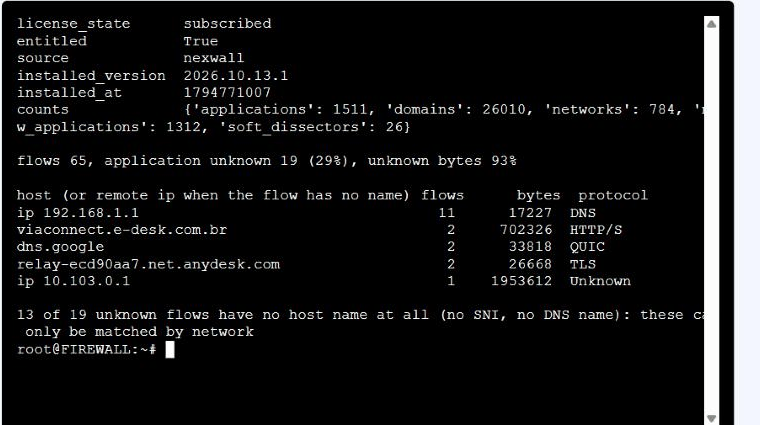

# KBA-22: O tráfego aparece como "Desconhecido" ou uma aplicação não é bloqueada pelo Controle de aplicações (DPI)

**Aplica-se a.** Nexwall Firewall 26.0.0 e posteriores (comandos verificados na 26.2.1).

## Sintomas

- Monitor > Fluxos ao vivo, ou as regras do Controle de aplicações, mostram muitos fluxos com aplicação "Desconhecida" (só o protocolo aparece, por exemplo `HTTPS` ou `DNS`).
- Uma regra que bloqueia uma aplicação não interrompe um serviço que deveria interromper.
- A parcela de tráfego desconhecido é alta logo depois do fim do período de teste.

## Como o firewall decide a que aplicação um fluxo pertence

O motor DPI lê o **nome** que uma conexão usa (o nome de servidor TLS, o nome DNS que o cliente consultou, ou uma pista aprendida de respostas DNS anteriores) e o procura no **catálogo de aplicações**: regras de domínio (`cnn.com` também cobre `edition.cnn.com`), regras de rede e algumas regras de protocolo. Sem regra, sem aplicação: o fluxo mantém só o protocolo. Conexões criptografadas sem nome legível (ICMP, IP puro, parte do tráfego QUIC/VPN) só podem ser associadas por rede.

Por isso "Desconhecido" quase sempre significa que **o catálogo não tem regra para aquele nome**, não que o motor falhou.

## Verifique (2 minutos)


*Saída de nexwall-dpi-catalog status e dpidbg unknown*

1. **Qual catálogo está em uso?** Controle de aplicações (DPI) > Configurações mostra a origem: o **catálogo Nexwall** (cerca de 1.500 aplicações) ou a **lista integrada** (199 aplicações). Na CLI: `nexwall-dpi-catalog status`.
   - `source: open` e licença `trial` ou `subscribed`: o catálogo ainda não está instalado. Pressione **Atualizar agora**, ou leia `last_error` no status (sem rota até o servidor de licenças? unidade ainda não registrada?).
   - `source: open` e licença `unlicensed`: o teste acabou e não há assinatura ativa; a lista integrada está em uso por projeto. Ativar uma assinatura restaura o catálogo automaticamente em cerca de 10 minutos.
2. **O que exatamente é desconhecido?**
   ```sh
   dpidbg unknown -n 30
   ```
   Lista a parcela de fluxos e bytes desconhecidos e os principais hosts por trás deles, e quantos fluxos desconhecidos não têm nome algum.
3. **Precisa do detalhe de um cliente?** Uma captura de depuração curta (pausa a inspeção enquanto roda; use uma janela de manutenção):
   ```sh
   dpidbg capture -s 45 -i <ip-do-cliente>
   ```
   A última seção, "protocol-only flows by host", é a lista de nomes a incluir no catálogo.

## Resolução

| Achado | O que fazer |
|---|---|
| Lista integrada em uso embora haja licença | Controle de aplicações (DPI) > Configurações > **Atualizar agora**; verifique o erro exibido |
| Teste encerrado, sem assinatura | Ative uma assinatura (Administração > Licenciamento) |
| Catálogo instalado, um serviço continua desconhecido | Envie ao suporte os nomes de host do `dpidbg capture`; eles são incluídos no catálogo (adições curadas são publicadas com a próxima versão do catálogo) |
| Fluxos sem nome | Esperado em ICMP e tráfego IP puro; bloqueie por rede com uma regra de firewall ou um objeto |
| Uma regra de bloqueio não impede um app | O serviço pode ser entregue por uma CDN classificada como aplicação própria (por exemplo um site de vídeo cuja mídia vem da Fastly); crie uma regra para essa aplicação também, ou veja em Fluxos ao vivo qual aplicação têm os fluxos que parecem bloqueados |

## Configurações

Controle de aplicações (DPI) > Configurações: atualização automática ligada/desligada e a frequência de verificação (de hora em hora a semanal). Desligar as atualizações automáticas mantém o catálogo atual até você pressionar Atualizar agora, **exceto** que um catálogo que a licença não cobre mais é sempre substituído pela lista integrada.

## Notas

- Mudar uma regra do DPI vale em segundos (o motor recarrega as regras; sem reinício). Uma conexão que já estava bloqueada continua bloqueada até terminar, mesmo que a regra seja removida.
- Após uma atualização de firmware o catálogo é reinstalado automaticamente.
- Relacionado: [KBA-21](kba-21-dpi-engine-stall.md).
