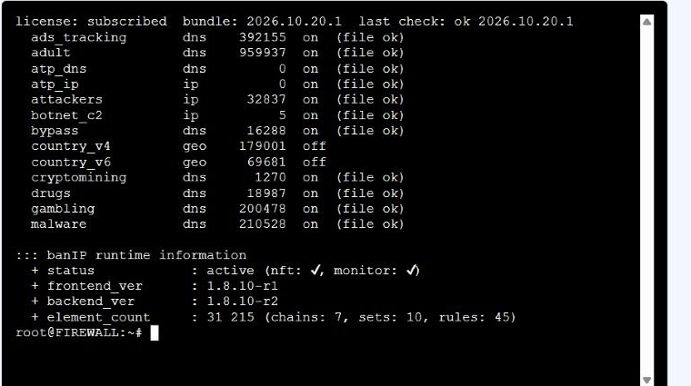

# KBA-0023: Listas do Threat Shield: verificar e resolver problemas

**Aplica-se a.** Nexwall Firewall 26.2.1. Como as listas funcionam e seu custo de memória: [KBA-0024](kba-24-threat-shield-lists.md).

## Solução de problemas

**Sem listas / "not licensed".** `nexwall-threat-feeds status` mostra `license: unlicensed` ou `last check: not licensed`. Registre o firewall ou peça um teste; verifique `licensectl state`.

**"update failed".** `status` mostra o motivo. Típico: o firewall não alcança o servidor de licenças (verifique `licensectl state`), ou um arquivo não bateu com seu hash assinado (tente de novo com `--force`; se repetir, envie a mensagem ao suporte). Uma atualização que falha nunca remove as listas já presentes no firewall.

**Categoria ligada mas não bloqueia.** `status` deve mostrar `(file ok)` para ela; se não, rode `nexwall-threat-feeds sync`. Depois `/etc/init.d/adblock status` deve listá-la nos feeds ativos. Teste: `nslookup <domínio listado> 127.0.0.1` responde NXDOMAIN. Um cliente que usa seu próprio DNS (DoH, um 8.8.8.8 fixo) contorna o filtro, a menos que a imposição de DNS esteja ligada (Threat Shield > Filtro DNS > Configurações: as portas 53 e 853 são redirecionadas ao firewall).

**Um site que deve funcionar está bloqueado.** Inclua o domínio na lista de permitidos do DNS (Threat Shield > Filtro DNS > Permitidos). Informe ao suporte com a categoria: falsos positivos são corrigidos na compilação diária (a compilação tem sua própria lista de permitidos de domínios críticos).

**banIP mostra "processing" por minutos.** O banIP baixa os feeds um a um. As listas IP da Nexwall são locais e levam segundos; a parte lenta é o bloqueio geográfico (feed `country`, um download por país, de terceiros) e qualquer feed da lista própria do banIP que esteja ligado. Veja `grep banIP /var/log/messages`.

**O DNS deixa de responder por um instante após uma mudança.** O dnsmasq reinicia para carregar as listas (veja [Memória e velocidade](kba-24-threat-shield-lists.md#memória-e-velocidade)). Se durar minutos, as listas são grandes demais para a memória: desligue as maiores categorias.

## Comandos

*Saída de nexwall-threat-feeds status e banIP status*

| Comando | O que faz |
|---|---|
| `nexwall-threat-feeds status` | estado da licença, versão do pacote, última verificação, cada categoria com entradas, ligada/desligada e se seu arquivo está no firewall |
| `nexwall-threat-feeds status --json` | o mesmo para scripts; inclui a memória DNS estimada das listas ligadas (`dns_memory_mib`) |
| `nexwall-threat-feeds update [--force]` | consulta o servidor e baixa o que está ligado (não toca adblock nem banIP) |
| `nexwall-threat-feeds sync` | atualiza e depois recarrega adblock e banIP se algo mudou (o que o cron executa) |
| `nexwall-threat-feeds feeds-dns` / `feeds-ip` | as definições de feeds entregues ao adblock / banIP (chamadas por `ts-dns` / `ts-ip`) |
| `/etc/init.d/adblock status` | domínios bloqueados, feeds ativos, memória do dnsmasq |
| `/etc/init.d/banip status` | elementos nos conjuntos IP, feeds ativos |

Arquivos: `/mnt/data/threat-feeds/` (catálogo `manifest.json`, `state.json`, uma pasta por versão, as duas mais novas são mantidas), `/etc/adblock/adblock.custom.feeds`, `/etc/banip/banip.custom.feeds`. Log: `grep nexwall-threat-feeds /var/log/messages`.

## O que coletar antes de contatar o suporte

`nexwall-threat-feeds status --json`, `/etc/init.d/adblock status`, `/etc/init.d/banip status`, `uci show adblock.global`, `uci show banip.global | grep -v oinkcode`, `grep -E "nexwall-threat-feeds|adblock|banIP" /var/log/messages | tail -50`, `free -m`, e o nome do domínio ou endereço bloqueado por engano ou que não é bloqueado.
