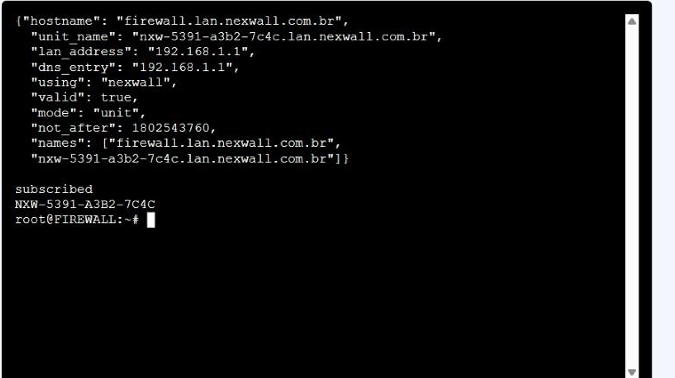

# KBA-0025: Endereço e certificado da interface web

Aplica-se ao firmware 26.0.0-rc4 e posteriores. O firmware até a rc3 usa um certificado compartilhado para `firewall.nexwall.com.br` (veja a última seção).

## O que digitar

| Endereço | Resultado |
|---|---|
| `https://firewall.lan.nexwall.com.br` | a interface web, **com um certificado em que o navegador confia** (sem aviso). É o endereço da etiqueta. |
| `https://<serie>.lan.nexwall.com.br` | o mesmo, pelo número de série da unidade em minúsculas, por exemplo `https://nxw-5391-a3b2-7c4c.lan.nexwall.com.br`. |
| `http://192.168.1.1` (ou o endereço da LAN que você configurou), `http://firewall.lan` | uma página pequena que abre o endereço confiável, ou mostra o link direto se o computador não consegue alcançá-lo. |
| `https://192.168.1.1`, `https://firewall.lan` | a interface web, mas o navegador **avisa sobre o certificado**: nenhuma autoridade pública emite certificados para endereços privados. Aceite o aviso uma vez ou use o endereço confiável. |

## Como funciona

1. O firewall responde sozinho os dois nomes acima: seu servidor DNS devolve o endereço LAN da unidade. Por isso o computador deve **usar o firewall como servidor DNS** (o padrão quando o computador recebe o endereço do firewall por DHCP).
2. A unidade gera sua própria chave privada (nunca sai da unidade) e pede ao servidor de licenças da Nexwall um certificado para seus dois nomes. O servidor consulta o Let's Encrypt, que valida os nomes por DNS, e a unidade instala a resposta depois de conferir a assinatura do servidor, os nomes e sua chave.
3. Isso começa alguns minutos após o primeiro registro no servidor de licenças (é preciso internet e uma unidade registrada) e é verificado a cada 30 minutos; o certificado é renovado automaticamente 28 dias antes de vencer (vale 90 dias).
4. Até que um certificado válido seja instalado, e sempre que ele deixar de ser válido, a interface web mantém (ou volta a) seu próprio certificado autoassinado, então sempre pode ser acessada pelo endereço direto.

## Comandos (no firewall)

*Saída de nexwall-webui-cert status, licensectl state e o número de série*

| Comando | O que faz |
|---|---|
| `nexwall-webui-cert status` | o que está em uso: `using` (`nexwall` ou `self-signed`), `valid`, `mode` (`unit` = o certificado desta unidade, `shared` = o compartilhado do firmware antigo, `none`), nomes, vencimento (segundos epoch) |
| `nexwall-webui-cert sync` | fazer agora: entradas DNS e depois solicitar/renovar o certificado (até cerca de 2,5 minutos enquanto a validação roda) |
| `nexwall-webui-cert dns` | só as entradas DNS (depois de mudar o endereço da LAN) |
| `nexwall-webui-cert revert` | voltar ao certificado autoassinado |
| `grep nexwall-webui-cert /var/log/messages` | o que aconteceu nas últimas execuções |

Verifique de um computador: `nslookup firewall.lan.nexwall.com.br 192.168.1.1` deve responder `192.168.1.1`.

## Solução de problemas

| Sintoma | Causa | O que fazer |
|---|---|---|
| O navegador avisa em `https://192.168.1.1` | esperado para um endereço, não um nome | use `https://firewall.lan.nexwall.com.br` |
| "Não é possível acessar este site" / `ERR_NAME_NOT_RESOLVED` para o nome confiável | o computador não usa o firewall como servidor DNS (DNS fixo como 8.8.8.8, uma VPN, "DNS seguro" no navegador, outro roteador na frente) | configure o computador para receber DNS do firewall, ou desligue o DNS seguro do navegador; teste com o `nslookup` acima. Enquanto isso use `http://192.168.1.1`, que mostra o link direto |
| A página da porta 80 diz que o endereço seguro não pôde ser alcançado | mesma causa | igual |
| O nome confiável abre mas o navegador ainda avisa (certificado autoassinado) | ainda não há certificado próprio instalado: `nexwall-webui-cert status` mostra `using: self-signed` | espere a próxima execução ou rode `nexwall-webui-cert sync`; leia as linhas do log; veja as linhas seguintes |
| `could not get the own certificate: ... HTTP 401` ou `DEVICE_ALREADY_REGISTERED` | a unidade não está registrada no servidor de licenças | veja [KBA-0026](kba-26-licensing.md): o revendedor faz **Reset device** e depois **Synchronize** na unidade |
| `could not get the own certificate: request failed` / timeout | sem internet ou sem DNS no firewall | verifique a WAN; `nslookup license.nexwall.com.br` no firewall |
| `the certificate is still being issued, the next run asks again` | a validação leva mais de 2,5 minutos | nada, a próxima execução (30 minutos) termina |
| `ISSUE_FAILED` com um texto | o Let's Encrypt ou a validação falhou desta vez | o servidor tenta de novo após 15 minutos; se repetir por horas, envie o texto ao suporte |
| `RATE_LIMIT` | esta unidade pediu mais de 4 certificados novos em uma semana (típico após vários resets de fábrica: cada um gera uma chave nova) | espere uma semana ou consulte o suporte |
| `NAMES` ou `UNIT_SERIAL` | o número de série da unidade está ausente ou mudou | `cat /etc/nexwall-license/serial` deve mostrar `NXW-XXXX-XXXX-XXXX`; registre a unidade de novo ([KBA-0026](kba-26-licensing.md)) |
| `ERR_CERT_DATE_INVALID` ou "certificado ainda não válido" | o relógio do computador ou do firewall está errado | acerte a hora nos dois; no firewall `date` e as configurações de NTP |
| O nome parou de funcionar após mudar o endereço da LAN | as entradas DNS apontam para o endereço antigo | `nexwall-webui-cert dns` (também acontece sozinho em 30 minutos) |
| Outro servidor DNS na frente bloqueia o nome ("DNS rebinding protection") | um endereço privado na resposta de um nome público é descartado | permita `lan.nexwall.com.br` como domínio privado nesse servidor DNS, ou faça os computadores consultarem o firewall |
| A interface web não abre depois de uma mudança de certificado | o servidor web não aceitou os arquivos novos | a ferramenta volta sozinha ao certificado autoassinado; se não: `nexwall-webui-cert revert` |

## Bom saber

- Cada unidade tem um certificado e uma chave diferentes. Um reset de fábrica (ou reinstalação) gera uma chave nova e uma nova solicitação de certificado.
- Os certificados são emitidos pelo Let's Encrypt; os nomes `firewall.lan.nexwall.com.br` e o nome com o número de série são nomes públicos nos logs de transparência de certificados (contêm o número de série da unidade, nenhum outro dado).
- Firmware antigo (até 26.0.0-rc3): `https://firewall.nexwall.com.br` com um certificado compartilhado, nada a configurar. O firmware novo o mantém só como reserva.
