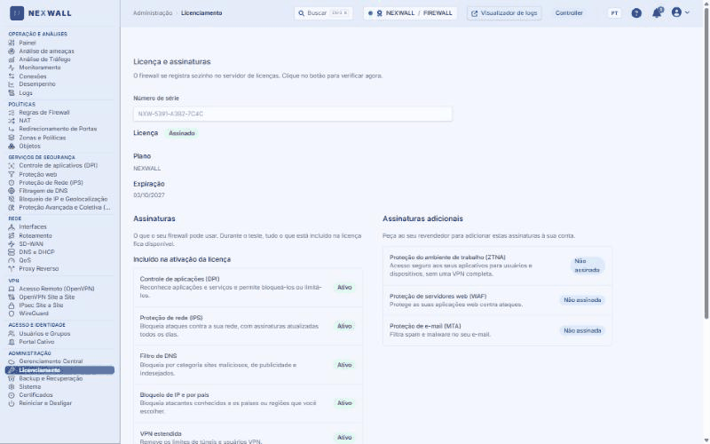

# KBA-26: Licenciamento, assinaturas e registro

**Aplica-se a.** Nexwall Firewall 26.0.0 e posteriores (comandos verificados na 26.2.1).

## Como um firewall obtém licença

1. O firewall se registra sozinho: o componente de licenciamento se apresenta ao servidor de licenças (`https://license.nexwall.com.br`) após a primeira partida, quando a rede está ativa, e depois a cada 15 minutos. Nenhum código é digitado. A unidade aparece no painel como **não atribuída**, com seu número de série (`NXW-XXXX-XXXX-XXXX`).
2. Começa com um **teste de 30 dias** (o painel pode estendê-lo, quantas vezes for preciso). Durante o teste os cinco módulos base estão disponíveis: Controle de aplicações (DPI), Proteção de rede (IPS), Filtro DNS, Bloqueio de IP e geo e VPN Estendida.
3. O revendedor atribui o número de série a um parceiro no painel e aplica a assinatura (abaixo). Só então a unidade passa a **Assinada**. Estar atribuída a um parceiro não basta.
4. A licença assinada (um arrendamento de 14 dias, renovado a cada verificação) lista os módulos. Web Server Protection (WAF) e Email Protection (MTA) são complementos separados: aparecem como "Não assinado" e seus recursos ainda não estão disponíveis.

## No firewall

*Administração > Licenciamento*

Página Licenciamento: número de série, o estado (Teste com os dias restantes, Assinada, Sem licença), as assinaturas (ativas / não ativas, módulos base e adicionais) e o botão **Sincronizar com o servidor**. Pela linha de comando: `ubus call ns.subscription info`, `ubus call ns.subscription sync`, `licensectl state`, `licensectl entitlements`.

## Solução de problemas

| Sintoma | Causa | O que fazer |
|---|---|---|
| A página diz que o firewall ainda não falou com o servidor | ainda sem internet, ou a primeira verificação não rodou | pressione **Sincronizar com o servidor**; verifique a WAN e o DNS |
| "already registered ... ask your reseller to reset the device" (`DEVICE_ALREADY_REGISTERED`) | a unidade foi reinstalada e o servidor ainda guarda seu token de dispositivo antigo | revendedor: página Firewalls, **Reset device**; depois pressione **Sincronizar** na unidade |
| IPS, listas DNS ou catálogo de aplicações falham com HTTP 401 | igual ao acima: sem token de dispositivo válido | igual ao acima |
| Teste embora a unidade esteja atribuída | o parceiro não tem assinatura de módulos vigente | **Activate license** na página do parceiro |
| Um módulo mostra "Não ativo" | o parceiro não tem assinatura para ele, ou ela expirou | página do parceiro, assinaturas |

O teste que uma unidade recebe sem nenhum contato com o servidor (primeiras 24 horas) é só uma partida: depois disso a unidade fica sem licença até falar com o servidor.

## Para revendedores: painel do servidor de licenças

| Tarefa | Onde |
|---|---|
| Assinar um parceiro nos cinco módulos base | Página do parceiro, **Activate license** |
| Assinar ou remover um módulo (com data de fim própria) | Página do parceiro, tabela **Modules & Subscriptions**, **Save subscriptions** |
| Atribuir uma unidade | Página Firewalls, **Assign to...** |
| Estender o teste | Página Firewalls, **Extend trial +30d** |
| Deixar uma unidade reinstalada se registrar de novo | Página Firewalls, **Reset device** |
