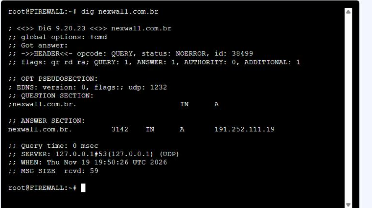
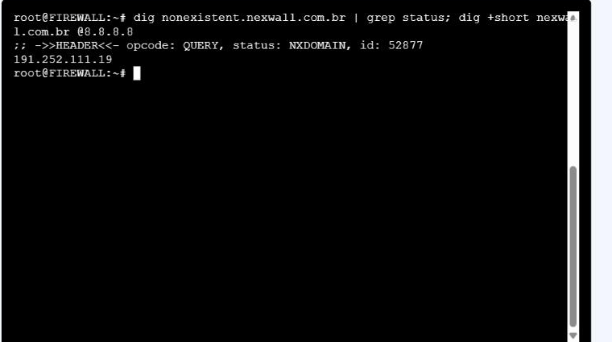

# KBA: Solucionar problemas de DNS pela linha de comando

**Sintoma.** Um site ou serviço "não abre", mas o ping para o endereço IP dele funciona. Ou um nome resolve no seu
notebook e não resolve na LAN.

**Aplica-se a.** Nexwall Firewall 26.2.1. Os comandos rodam como `root` por SSH, pelo console ou pelo
[terminal do controller](../administration/central-management.md).

:::note O que está instalado
`dig` e `nslookup` estão instalados e funcionam de fábrica. **`host` não está instalado**, e `telnet` também não
(veja na [KBA de conectividade](kba-cli-connectivity.md) os substitutos). Se um comando responder `not found`,
confira a grafia e use `command -v <nome>` antes de supor uma falha.
:::

## 1. Pergunte ao resolvedor da própria unidade

```bash
dig nexwall.com.br
```

```text
;; ->>HEADER<<- opcode: QUERY, status: NOERROR, id: 60522
;; flags: qr rd ra; QUERY: 1, ANSWER: 1, AUTHORITY: 0, ADDITIONAL: 1

;; ANSWER SECTION:
nexwall.com.br.		3594	IN	A	191.252.111.19

;; Query time: 0 msec
;; SERVER: 127.0.0.1#53(127.0.0.1) (UDP)
```



*Captura: dig respondido pelo resolvedor da própria unidade, status NOERROR.*


Leia três coisas: o **`status`**, a **ANSWER SECTION** e a linha **SERVER**. O servidor é `127.0.0.1`, o resolvedor
do próprio firewall (`dnsmasq`). Para uma resposta curta, acrescente `+short`:

```bash
dig +short nexwall.com.br
```

| `status` | Significado | Próximo passo |
|---|---|---|
| `NOERROR` com resposta | O nome resolve | O problema não é DNS, vá para a [KBA de conectividade](kba-cli-connectivity.md) |
| `NOERROR` **sem** resposta | O nome existe mas não tem registro desse tipo (por exemplo, sem `AAAA`) | Tente `dig A <nome>` e `dig AAAA <nome>` |
| `NXDOMAIN` | O nome não existe | Confira a grafia e compare com um resolvedor público (passo 2) |
| `SERVFAIL` | O servidor de saída não conseguiu responder | Teste os servidores de saída (passo 3) |
| `communications error ... timed out` | O servidor não respondeu | O resolvedor está parado ou inalcançável (passo 4) |

## 2. Compare com um resolvedor público

Pergunte direto a um servidor público, sem passar pelo resolvedor do firewall:

```bash
dig +short nexwall.com.br @8.8.8.8
```

```text
191.252.111.19
```



*Captura: NXDOMAIN para um nome que não existe e a resposta de um resolvedor público para comparação.*


| Resolvedor do firewall | Resolvedor público | Conclusão |
|---|---|---|
| Falha | Funciona | O problema está dentro do firewall: `dnsmasq`, seus servidores de saída ou a [filtragem de DNS](../security-services/dns-filtering.md) |
| Funciona | Funciona | O DNS está bem; olhe o cliente (a configuração de DNS, um cache, uma VPN ou um proxy no PC) |
| Falha | Falha | O nome realmente não resolve, ou o firewall está sem internet. Verifique a WAN primeiro |

A [filtragem de DNS](../security-services/dns-filtering.md) também pode mudar para onde um nome resolve, então uma
categoria filtrada parece um problema de DNS no cliente. Quando um site falha e o resto funciona, compare as duas
respostas e confira as listas de filtragem antes de procurar em outro lugar.

## 3. Verifique os servidores de saída

O firewall encaminha para os servidores que recebeu do provedor ou que você definiu na página DNS e DHCP.

```bash
cat /etc/resolv.conf
cat /tmp/resolv.conf.d/resolv.conf.auto
```

```text
search lan
nameserver 127.0.0.1
nameserver ::1
```

O `/etc/resolv.conf` sempre aponta para o próprio firewall. Os servidores para os quais ele encaminha estão em
`resolv.conf.auto`, um bloco por interface (aqui a WAN, cujo gateway também atua como resolvedor):

```text
# Interface wan
nameserver 192.168.0.1
search Home
```

Teste cada servidor de saída:

```bash
dig +short nexwall.com.br @<servidor-de-saida> +time=3 +tries=1
```

O servidor que não responde é o que deve ser removido ou trocado. Dois ou mais servidores funcionando evitam um
ponto único de falha.

## 4. Um tempo esgotado: o resolvedor é alcançável?

```bash
dig +short nexwall.com.br @10.255.255.1 +time=2 +tries=1
```

```text
;; communications error to 10.255.255.1#53: timed out
;; no servers could be reached
```

É assim que um servidor inalcançável aparece (o código de saída é `9`). Em seguida:

```bash
/etc/init.d/dnsmasq status
netstat -tulnp | grep ':53 '
```

```text
running
tcp   0   0 192.168.1.1:53   0.0.0.0:*   LISTEN   103916/dnsmasq
udp   0   0 192.168.1.1:53   0.0.0.0:*            103916/dnsmasq
```

Se o `dnsmasq` não estiver rodando, ou nada escutar no endereço da LAN, reinicie-o e leia o log:

```bash
/etc/init.d/dnsmasq restart
grep dnsmasq /var/log/messages | tail -20
```

Para conferir a configuração sem reiniciar:

```bash
dnsmasq --test
```

```text
dnsmasq: syntax check OK.
```

## 5. Acompanhe a resolução desde a raiz

Quando a resposta está errada, ou só alguns nomes falham, rastreie o caminho todo:

```bash
dig +trace nexwall.com.br
```

O rastreio vai dos servidores raiz até os autoritativos. Linhas como
`UDP setup ... failed: network unreachable` para endereços IPv6 são normais numa rede sem IPv6; olhe a última
linha, que traz a resposta final e de onde ela veio.

## 6. Referência rápida

| Tarefa | Comando |
|---|---|
| Resolver com o resolvedor da unidade | `dig <nome>` |
| Só a resposta curta | `dig +short <nome>` |
| Um tipo de registro específico | `dig MX <nome>`, `dig AAAA <nome>`, `dig TXT <nome>` |
| Usar um servidor específico | `dig @1.1.1.1 <nome>` |
| Consulta reversa | `dig -x <ip>` |
| Caminho completo desde a raiz | `dig +trace <nome>` |
| O mesmo com `nslookup` | `nslookup <nome>` ou `nslookup <nome> <servidor>` |
| DNS sobre HTTPS | `dig +https @8.8.8.8 <nome>` |
| Capturar tráfego DNS na WAN | `tcpdump -i <interface-wan> -n udp port 53` |

## Páginas relacionadas

- [KBA: Testar conectividade, portas e tráfego pela linha de comando](kba-cli-connectivity.md)
- [KBA: Verificar e solucionar problemas de serviços pela linha de comando](kba-cli-services.md)
- [DNS e DHCP](../network/dns-dhcp.md)
- [Filtragem de DNS](../security-services/dns-filtering.md)
- [Ferramentas de solução de problemas de rede](network-troubleshooting-tools.md)
