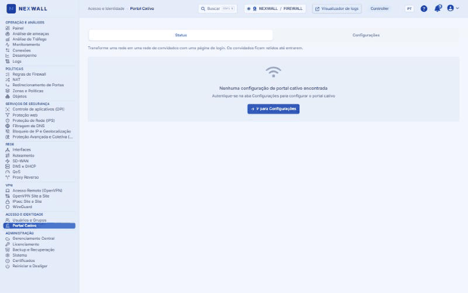

# Como transformar uma rede em rede de convidados com página de login (Portal Cativo)

A unidade conecta-se a um gerenciador remoto de portal cativo que fornece a página de login e as contas. A unidade aplica o acesso de cada convidado.

**Onde:** **Acesso e Identidade** > **Portal Cativo**

## Antes de começar

- O endereço e uma conta de administrador do seu gerenciador de portal cativo.
- Uma interface livre ou VLAN para a rede de convidados ([Como configurar uma interface de rede (WAN, LAN, VLAN)](../network/interface.md)).

## Passos

1. Abra a página e a aba **Configurações**.

   

2. Em **Login** informe o **Endpoint do gerenciador de portal cativo**, o **Usuário** e a **Senha** do gerenciador.
3. Em **Configuração do portal cativo** digite o **Nome da unidade de portal cativo** e a descrição. Escolha o **Dispositivo de rede** e defina o **Endereço de rede** e os limites DHCP (ou use a faixa DHCP padrão).
4. Clique em **Salvar e confirmar**: as alterações pendentes do firewall são aplicadas.
5. Abra a aba **Status**: as sessões de convidados aparecem com MAC, IP, status de login, tempo de sessão e tráfego.

## Confirme que funcionou

- Um dispositivo convidado que conecta é redirecionado à página de login e, após o login, aparece como **Autenticado**.

## Se não funcionar

- Sem dispositivo disponível: crie antes a interface (**Ir para Interfaces**).
- Use **Cancelar registro** para desvincular a unidade do gerenciador.

## Guias relacionados

- [Como configurar uma interface de rede (WAN, LAN, VLAN)](../network/interface.md)
- [Como criar uma zona e definir sua política](../policy/zone.md)
