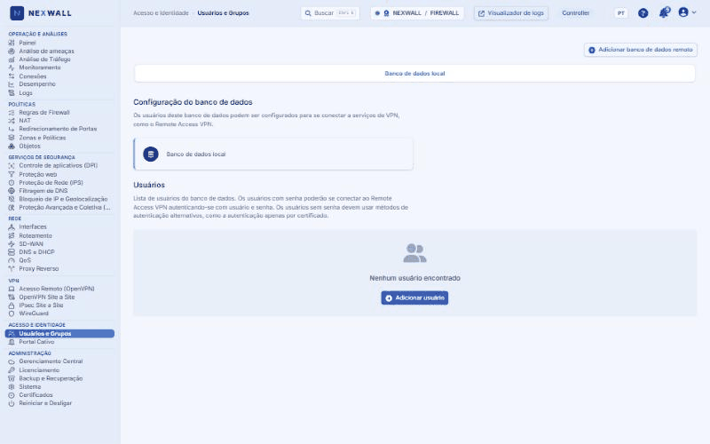

# Como criar usuários e conectar um diretório (LDAP / Active Directory)

A base de usuários é usada pelos servidores VPN. Você pode manter os usuários localmente ou lê-los do seu diretório.

**Onde:** **Acesso e Identidade** > **Usuários e Grupos**

## Passos

1. Abra a página.

   

2. Para um usuário local clique em **Adicionar usuário**, digite o **Usuário**, o **Nome de exibição** e uma **Senha** forte (mínimo 8 caracteres, maiúsculas e minúsculas, um número e um caractere especial). Salve.
3. Para permitir que um usuário administre o firewall use **Definir como usuário administrador** no menu da linha.
4. Para ler usuários de um diretório clique em **Adicionar banco de dados remoto** e escolha **Active Directory remoto** ou **LDAP remoto (RFC 2307)**. Preencha o **Nome do banco de dados**, o **URI do LDAP**, o **DN base** e o **DN de bind** com sua **Senha de bind**.
5. Clique em **Testar**: você deve ver **Conexão verificada** e o número de usuários encontrados. Salve.
6. Selecione a base no servidor VPN ([Como permitir que usuários conectem de casa (acesso remoto OpenVPN)](../vpn/openvpn-remote-access.md)).

## Confirme que funcionou

- Os usuários aparecem na lista. Um login VPN com esse usuário funciona.

## Se não funcionar

- O teste do diretório falha: URI LDAP, porta 636 com verificação do certificado, DNS e a conta de vínculo. Teste `nc -vz <servidor> 636` no console.

## Guias relacionados

- [Como permitir que usuários conectem de casa (acesso remoto OpenVPN)](../vpn/openvpn-remote-access.md)
- [Como configurar o WireGuard (servidor com peers ou túnel de peer)](../vpn/wireguard.md)
