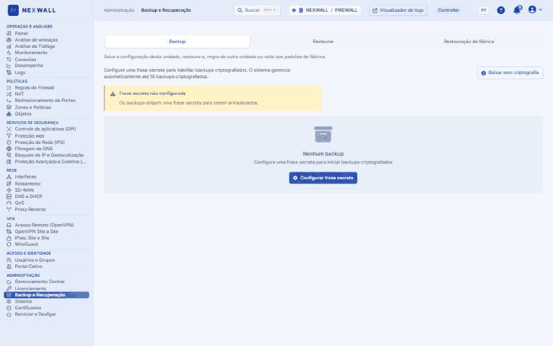

# Como fazer backup e restaurar a configuração

Um backup contém toda a configuração. Faça um antes de cada mudança importante.

**Onde:** **Administração** > **Backup e Recuperação**

## Passos

1. Abra a página, aba **Backup**.

   

2. Clique em **Configurar frase secreta** e defina uma senha de criptografia. Guarde bem: ela é necessária para restaurar.
3. Clique em **Baixar backup** para salvar um arquivo criptografado no seu computador, ou **Executar backup na nuvem** para enviar à nuvem (assinatura).
4. Para restaurar abra a aba **Restaurar**, escolha o arquivo (ou um backup na nuvem), informe a senha e confirme. A unidade reinicia.
5. Para levar a configuração a uma unidade nova use a aba **Migração**.

## Confirme que funcionou

- O backup aparece em **Backups** com data e tamanho. Após restaurar, as regras e redes estão de volta.

## Se não funcionar

- Senha perdida: o backup criptografado não pode ser aberto. Guarde no gerenciador de senhas.
- A aba **Restauração de fábrica** apaga tudo: use só para recomeçar do zero.

## Guias relacionados

- [Como atualizar o firewall (agora ou agendado)](update.md)
- [Como registrar a licença e verificar a assinatura](licensing.md)
