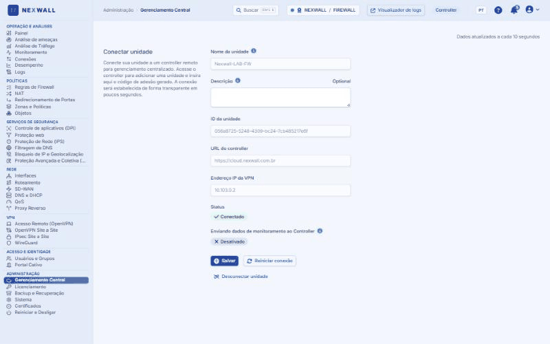

# Como conectar o firewall ao Cloud Controller

O Gerenciamento Central conecta a unidade a um controlador por um túnel seguro para acesso remoto, monitoramento e gestão de grupos.

**Onde:** **Administração** > **Gerenciamento Central**

## Antes de começar

- O endereço do controlador e um código de adesão gerado no controlador.
- Acesso de saída à internet pelo firewall.

## Passos

1. Abra a página e clique em **Conectar unidade**.

   

2. Preencha a **URL do controller** e o **Código de adesão ao controller**. Mantenha **Verificar certificado TLS** ligado.
3. Clique em **Conectar unidade**. O estado passa de **Pendente** para **Conectado**.
4. No controlador, a unidade aparece na lista com seu nome e endereço VPN.

## Confirme que funcionou

- A página mostra **Conectado**, o **Endereço IP da VPN** e a última vez que dados foram enviados.

## Se não funcionar

- Fica pendente: código expirado ou saída bloqueada. Veja [Controller registration troubleshooting](../../help/controller-registration-troubleshooting.md).
- Use **Reiniciar conexão** para reconectar ou **Desconectar unidade** para sair do controlador.

## Guias relacionados

- [Como registrar a licença e verificar a assinatura](licensing.md)
