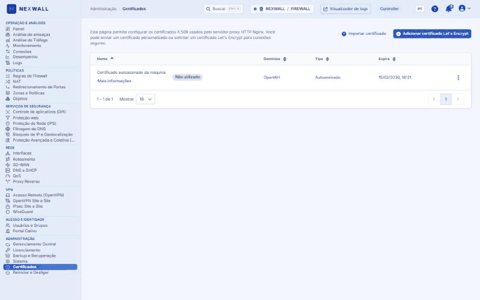

# Como instalar um certificado web confiável (Let's Encrypt ou importado)

O certificado de fábrica é autoassinado e os navegadores alertam. Um certificado confiável remove o alerta e é necessário para alguns serviços.

**Onde:** **Administração** > **Certificados**

## Antes de começar

- Um nome DNS que aponte para o endereço público do firewall (ou uma API DNS para validação).
- Para Let's Encrypt, a porta TCP 80 acessível no método Standalone.

## Passos

1. Abra a página.

   

2. Para Let's Encrypt clique em **Adicionar certificado Let's Encrypt**: digite o **Nome do certificado**, adicione o **Domínio** e escolha o **Método de validação** (**Standalone**, **DNS** ou **API de DNS**). Clique em **Adicionar certificado**.
3. Para usar seu próprio certificado clique em **Importar certificado**: escolha o arquivo **Certificado**, a **Chave privada** e, se tiver, a **Arquivo de cadeia**.
4. Na linha do certificado use **Definir como padrão** para usá-lo na interface web.

## Confirme que funcionou

- A linha do certificado mostra os domínios e a data de **Expira**, e o navegador mostra o cadeado.

## Se não funcionar

- A validação falha: porta 80 bloqueada ou o nome não aponta para o firewall.
- Os alertas persistem: [KBA-0025](../../help/kba-25-web-certificate.md).

## Guias relacionados

- [Como publicar uma aplicação web com o proxy reverso](../network/reverse-proxy.md)
- [Como definir o nome do host, o fuso horário e o NTP](system-settings.md)
