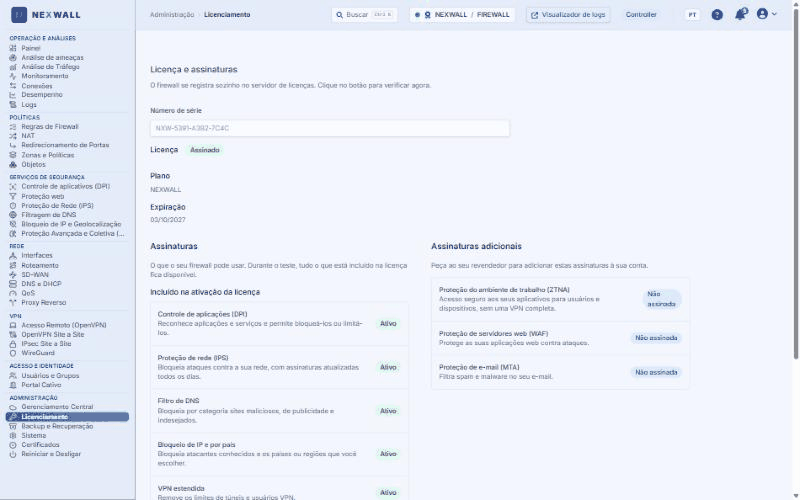

# Como registrar a licença e verificar a assinatura

A unidade se registra no servidor de licenças. Uma assinatura libera o catálogo ampliado de aplicativos, as listas de bloqueio avançadas, as atualizações automáticas, o backup remoto e mais.

**Onde:** **Administração** > **Licenciamento**

## Passos

1. Abra a página.

   

2. A página mostra o **Número de série**, o estado do **Registro** (**Teste: restam \{days\} dias**, **Assinado** ou **Sem licença (recursos limitados)**), o **Plano** e a **Expiração**.
3. Se a unidade não está registrada, cole o **Token de autenticação** recebido e clique em **Registrar**.
4. Clique em **Sincronizar agora** para atualizar o status imediatamente.
5. A lista de recursos mostra quais estão **Ativo** no seu plano.

## Confirme que funcionou

- O estado é **Assinado** e os recursos do plano estão ativos.

## Se não funcionar

- Não sincroniza: o firewall precisa de HTTPS de saída. Veja [KBA-26](../../help/kba-26-licensing.md).

## Guias relacionados

- [Como conectar o firewall ao Cloud Controller](central-management.md)
- [Como atualizar o firewall (agora ou agendado)](update.md)
