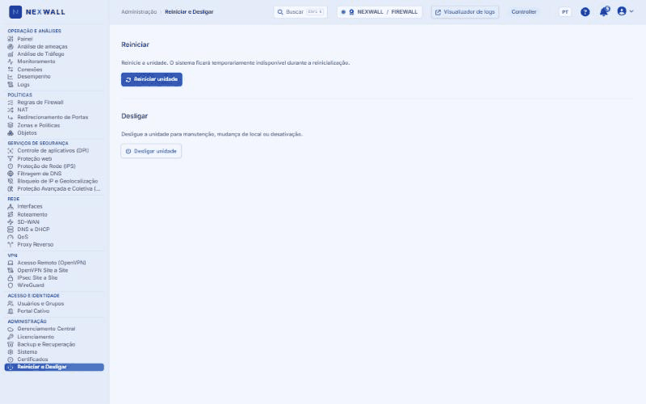

# Como reiniciar ou desligar o firewall com segurança

Use a interface web em vez de cortar a energia: o sistema fecha os serviços e salva o estado.

**Onde:** **Administração** > **Reiniciar e Desligar**

## Passos

1. Abra a página.

   

2. Clique em **Reiniciar unidade** para reiniciar ou **Desligar unidade** para desligar.
3. Leia o aviso. Se há alterações não salvas, serão perdidas: aplique ou descarte antes.
4. Confirme com **Reiniciar agora**. Aguarde a mensagem de reinicialização concluída; a página recarrega sozinha.

## Confirme que funcionou

- O painel mostra um **Tempo ligado** curto após o reinício.

## Se não funcionar

- Não volta: aguarde até cinco minutos; se continuar, use o console da VM.

## Guias relacionados

- [Como atualizar o firewall (agora ou agendado)](update.md)
- [Como fazer backup e restaurar a configuração](backup-restore.md)
