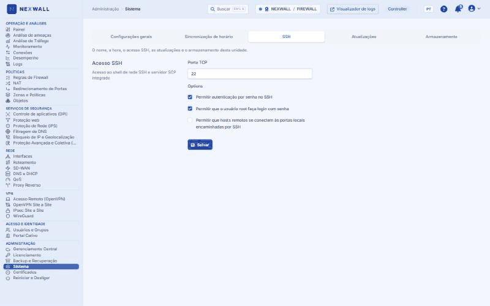

# Como gerenciar o acesso SSH

O SSH é a porta para a linha de comando usada pelas KBAs. Restrinja quem pode alcançá-lo.

**Onde:** **Administração** > **Sistema**

## Passos

1. Abra **Sistema** e escolha a aba **SSH**.

   

2. Em **Acesso SSH** defina a **Porta TCP** se quiser uma diferente de 22.
3. Decida sobre **Permitir autenticação por senha no SSH** e **Permitir que o usuário root faça login com senha**. Se só administradores de confiança precisam de acesso, desligue as senhas.
4. Salve e aplique. Mantenha aberta a sessão atual e teste uma nova antes de fechá-la.

## Confirme que funcionou

- `ssh root@<firewall>` na porta configurada abre um shell.

## Se não funcionar

- Bloqueado: use o console da VM ou o terminal remoto do controlador.
- SSH acessível pela internet: restrinja com uma regra de entrada ([Como permitir ou bloquear tráfego com uma regra de firewall](../policy/firewall-rule.md)).

## Guias relacionados

- [Como definir o nome do host, o fuso horário e o NTP](system-settings.md)
- [Como permitir ou bloquear tráfego com uma regra de firewall](../policy/firewall-rule.md)
