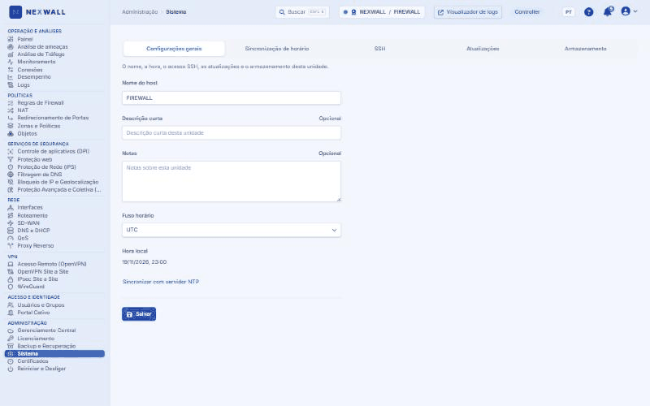

# Como definir o nome do host, o fuso horário e o NTP

Um relógio correto importa para logs, certificados, VPNs e licenciamento.

**Onde:** **Administração** > **Sistema**

## Passos

1. Abra a página. A primeira aba mostra **Configurações gerais**.

   

2. Digite o **Nome do host** e, opcionalmente, **Notas** sobre a unidade.
3. Escolha o **Fuso horário**. Em **Sincronização de horário** mantenha **Ativar cliente NTP** ligado e adicione seu próprio **Adicionar servidor NTP** se tiver.
4. Para que a LAN use o firewall como servidor de hora ative **Fornecer servidor NTP** e escolha a interface.
5. Salve. As abas **SSH**, **Atualizações** e **Armazenamento** estão na mesma página ([Como gerenciar o acesso SSH](ssh.md), [Como atualizar o firewall (agora ou agendado)](update.md)).

## Confirme que funcionou

- **Hora local** confere com seu relógio.

## Se não funcionar

- Hora errada após reiniciar: NTP bloqueado. Libere UDP 123 para a internet ou use um servidor local.

## Guias relacionados

- [Como gerenciar o acesso SSH](ssh.md)
- [Como atualizar o firewall (agora ou agendado)](update.md)
