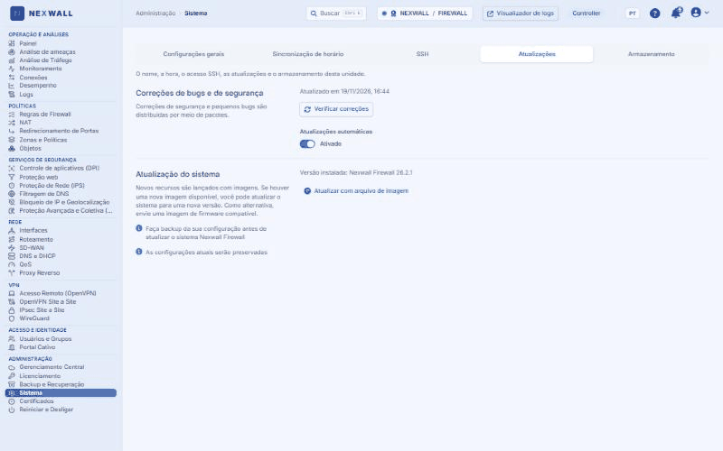

# Como atualizar o firewall (agora ou agendado)

As atualizações mantêm sua configuração. Faça sempre um backup antes ([Como fazer backup e restaurar a configuração](backup-restore.md)).

**Onde:** **Administração** > **Sistema**

## Passos

1. Abra **Sistema** e escolha a aba **Atualizações**.

   

2. A página mostra a **Versão instalada: \{release\}** e se há uma versão nova. Clique em **Verificar correções** para atualizar.
3. Quando aparecer **Nova versão disponível**, clique em **Atualizar para a versão**. Em **Escolha quando atualizar** escolha **Agora** ou **Agendar data e hora** e escolha um momento tranquilo.
4. Confirme com **Atualizar e reiniciar**. A unidade reinicia; a interface web volta em poucos minutos.
5. Para uma unidade sem internet use **Atualizar com arquivo de imagem** e escolha o arquivo de imagem.
6. Para instalar correções automaticamente ative **Atualizações automáticas**.

## Confirme que funcionou

- A versão instalada é a nova e o painel mostra os serviços em execução.

## Se não funcionar

- A atualização falha: verifique espaço e conectividade, veja [KBA-10](../../help/kba-10-updates.md).
- Após a atualização algo está errado: restaure o backup ([Como fazer backup e restaurar a configuração](backup-restore.md)).

## Guias relacionados

- [Como fazer backup e restaurar a configuração](backup-restore.md)
- [Como registrar a licença e verificar a assinatura](licensing.md)
