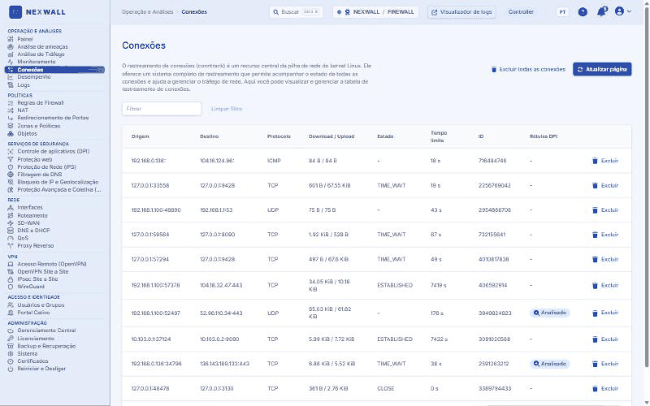

# Como ver e derrubar conexões ativas

A página Conexões mostra a tabela de rastreamento do kernel: cada conexão que o firewall acompanha, com seu estado e o resultado do DPI.

**Onde:** **Operação e Análises** > **Conexões**

## Passos

1. Abra **Conexões**.

   

2. Leia as colunas **Origem**, **Destino**, **Protocolo**, **Download** / **Upload**, **Estado** e **Tempo limite**. A coluna **Rótulos DPI** mostra **Analisado** ou **Bloqueado**.
3. Digite um endereço no filtro para isolar um dispositivo ou destino.
4. Para encerrar uma conexão clique em **Excluir conexão** na linha dela e confirme. O cliente reconecta, já sob as regras atuais.
5. Clique em **Atualizar página** para atualizar a lista.

## Confirme que funcionou

- Depois de alterar uma regra, excluir a conexão antiga faz a nova regra valer para ela.

## Se não funcionar

- **Excluir todas as conexões** derruba todas as conexões, inclusive sua própria sessão: use só numa janela de manutenção.

## Guias relacionados

- [Como ver quem usa a rede (Traffic Analytics)](traffic-analytics.md)
- [Como permitir ou bloquear tráfego com uma regra de firewall](../policy/firewall-rule.md)
