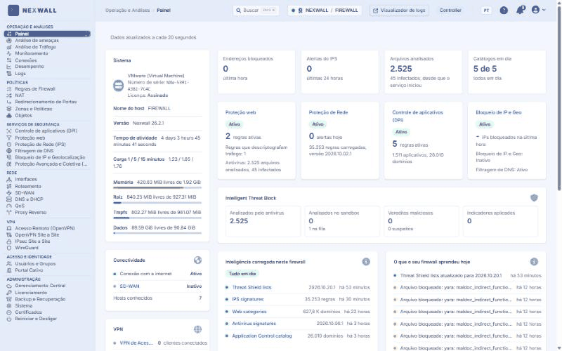

# Como ler o painel

O painel é a primeira página após o login. Mostra num relance se a unidade está saudável.

**Onde:** **Operação e Análises** > **Painel**

## Passos

1. Abra **Painel**.

   

2. Em **Sistema** confira o **Nome do host**, o **Número de série**, a **Licença**, a **Versão** e o **Tempo de atividade**. Um tempo ligado muito curto indica reinício recente.
3. Veja **Carga 1 / 5 / 15 minutos**: valores acima do número de núcleos por muito tempo indicam sobrecarga.
4. Confira os cartões de estado dos serviços (**SD-WAN**, **DPI-core**, **Portal Cativo**, **Bloqueio de IP e Geo**, **VPN de Acesso Remoto**): **Ativo**, **Inativo** ou **Aviso**.
5. Em **Tráfego da WAN** escolha a **Interface WAN** e leia as taxas de **Baixar** e **Enviar**.
6. Confira **Memória**, **Raiz** e **Dados**: mantenha longe do limite.

## Confirme que funcionou

- Todos os serviços que você usa estão **Ativo** e o armazenamento não está cheio.

## Se não funcionar

- Aviso do nome de host padrão: altere ([Como definir o nome do host, o fuso horário e o NTP](../admin/system-settings.md)).
- Um serviço está **Inativo**: abra a página dele e leia a mensagem.

## Guias relacionados

- [Como pesquisar nos logs](logs.md)
- [Como ver quem usa a rede (Traffic Analytics)](traffic-analytics.md)
