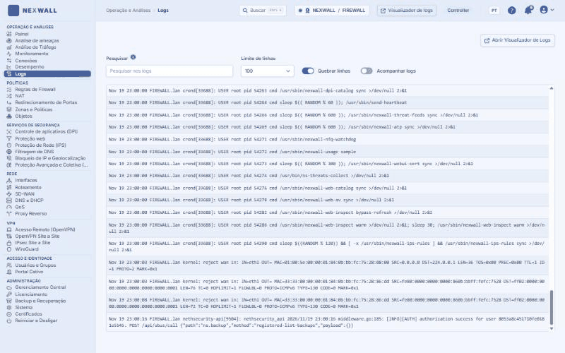

# Como pesquisar nos logs

Os logs são o primeiro lugar a olhar quando algo não funciona.

**Onde:** **Operação e Análises** > **Logs**

## Passos

1. Abra **Logs** e clique em **Abrir Visualizador de Logs**.

   

2. Defina o **Limite de linhas** que quer ver e ative **Acompanhar logs** para ver chegar as linhas novas.
3. Digite em **Pesquisar** uma palavra, um endereço IP ou uma expressão regular (por exemplo `192.168.1.50|dropped`).
4. Ative **Quebrar linhas** para ler linhas longas sem rolar para os lados.

## Confirme que funcionou

- Somente as linhas que correspondem à busca são mostradas.

## Se não funcionar

- Mensagem de expressão regular inválida: escape caracteres especiais como `.` ou `(`.
- Sem eventos do firewall: ative o log na regra ([Como permitir ou bloquear tráfego com uma regra de firewall](../policy/firewall-rule.md)).

## Guias relacionados

- [Como ler o painel](dashboard.md)
- [Como permitir ou bloquear tráfego com uma regra de firewall](../policy/firewall-rule.md)
