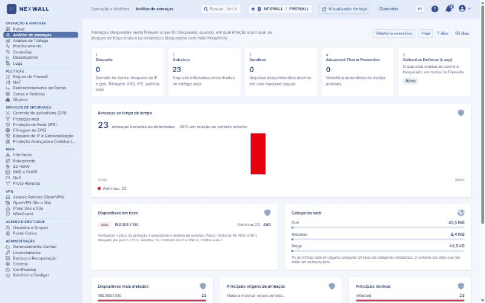

# Como revisar as ameaças bloqueadas e os dispositivos em risco

O Threat Analytics reúne o que cada proteção bloqueou ou detectou, para saber se um dispositivo precisa de atenção.

**Onde:** **Operação e Análises** > **Análise de ameaças**

## Passos

1. Abra **Análise de ameaças**.

   

2. Escolha o período. **Ameaças ao longo do tempo** mostra quantas ameaças foram bloqueadas ou detectadas, em relação ao período anterior.
3. As etapas **Bloqueio**, **Antivírus**, **Sandbox** e **Advanced Threat Protection** mostram quais proteções estão **Ativo** ou **Não ativado**.
4. Em **Dispositivos em risco** veja os dispositivos com maior pontuação e sua **Severidade**.
5. Embaixo, a tabela **Eventos** lista cada evento; filtre por **Proteção** ou busque um dispositivo ou endereço.

## Confirme que funcionou

- Você consegue nomear o dispositivo com mais eventos e a proteção que os bloqueou.

## Se não funcionar

- Nada aparece: confirme que as proteções estão ativas ([Como ativar a prevenção de intrusões (IPS)](../security/ips.md), [Como bloquear domínios maliciosos (Filtragem de DNS)](../security/dns-filtering.md), [Como bloquear endereços IP e países maliciosos (Bloqueio de IP e Geolocalização)](../security/ip-geo-blocking.md)) e que o log está habilitado.

## Guias relacionados

- [Como ativar a Proteção Avançada e Coletiva](../security/atp.md)
- [Como ativar a prevenção de intrusões (IPS)](../security/ips.md)
- [Como ver quem usa a rede (Traffic Analytics)](traffic-analytics.md)
