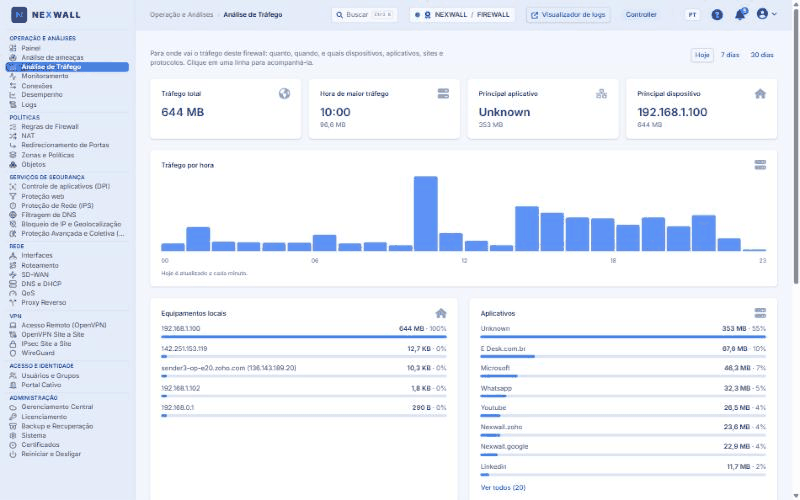

# Como ver quem usa a rede (Traffic Analytics)

O Traffic Analytics responde para onde vai o tráfego: quanto, quando e quais dispositivos, aplicativos, hosts remotos e protocolos.

**Onde:** **Operação e Análises** > **Análise de Tráfego**

## Passos

1. Abra **Análise de Tráfego**.

   

2. Escolha o período no topo. Os cartões mostram **Tráfego total**, **Hora de maior tráfego**, **Principal aplicativo** e **Principal dispositivo**.
3. Abaixo, as listas **Equipamentos locais**, **Aplicativos**, **Equipamentos remotos** e **Protocolos** ordenam o tráfego.
4. Clique em uma linha para filtrar tudo por ela (por exemplo um dispositivo) e ver quais aplicativos usa. Use **Limpar** para voltar.

## Confirme que funcionou

- Os gráficos e listas mudam ao selecionar um dispositivo ou aplicativo.

## Se não funcionar

- Página vazia: o motor DPI precisa estar ativo ([Como bloquear aplicativos e protocolos (Controle de aplicativos)](../security/app-control.md)). Os dados de hoje são atualizados a cada minuto.

## Guias relacionados

- [Como ver e derrubar conexões ativas](connections.md)
- [Como revisar as ameaças bloqueadas e os dispositivos em risco](threat-analytics.md)
