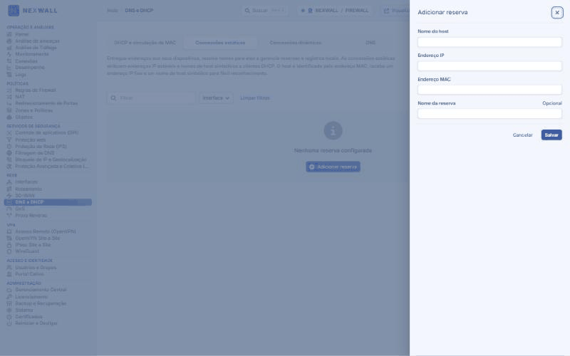

# Como reservar um endereço IP fixo para um dispositivo

Uma reserva vincula um endereço MAC a um endereço IP e um nome de host. Servidores que você publica com redirecionamento de portas devem ter uma.

**Onde:** **Rede** > **DNS e DHCP**

## Passos

1. Abra a página e escolha a aba **Concessões estáticas**.

   

2. Clique em **Adicionar reserva**.
3. Preencha o **Nome do host**, o **Endereço IP** (fora da faixa dinâmica ou dentro, mas sem uso por outro host) e o **Endereço MAC**. O **Nome da reserva** é opcional. Clique em **Salvar**.
4. Para achar o MAC de um dispositivo conectado abra a aba **Concessões dinâmicas** ou execute **Escanear rede** na aba **Escanear rede**; o resultado permite reservar com um clique.
5. Renove o endereço no dispositivo (desconecte e reconecte o cabo ou execute `ipconfig /renew`).

## Confirme que funcionou

- A reserva aparece na lista e o dispositivo recebe esse endereço.

## Se não funcionar

- O dispositivo mantém o endereço antigo: aguarde a concessão expirar ou renove no dispositivo.
- Uma reserva criada aqui também aparece como nome DNS; veja [Como definir servidores DNS e nomes DNS locais](dns-record.md).

## Guias relacionados

- [Como ativar e ajustar o servidor DHCP](dhcp-server.md)
- [Como publicar um servidor interno (redirecionamento de portas)](../policy/port-forward.md)
