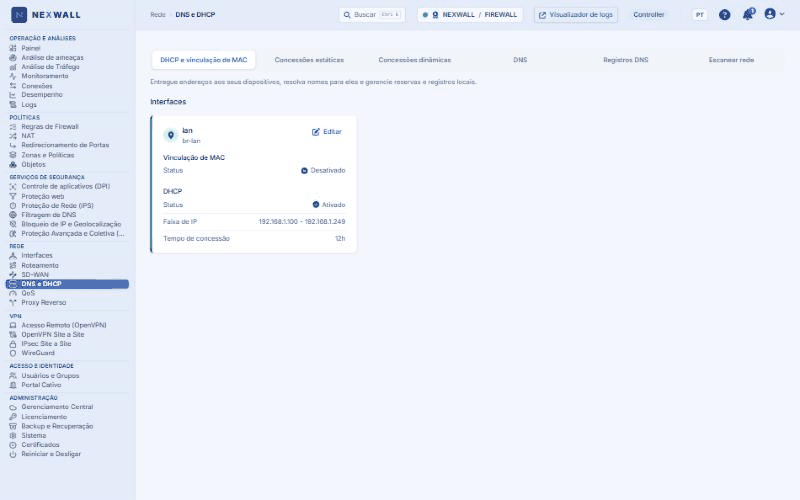

# Como ativar e ajustar o servidor DHCP

A primeira aba, **DHCP e vinculação de MAC**, mostra cada interface com seu estado DHCP, faixa de endereços e tempo de concessão.

**Onde:** **Rede** > **DNS e DHCP**

## Passos

1. Abra a página. No cartão da interface clique em **Editar \{interface\}**.

   

2. Ative **Ativar DHCP**. Preencha **IP inicial da faixa**, **IP final da faixa** e o **Tempo de concessão**.
3. Abra **Configurações avançadas** para definir o **IP do gateway**, o **Domínio** ou adicionar uma **Opção DHCP** (por exemplo a opção 66 para um servidor de provisionamento).
4. Para aceitar só dispositivos conhecidos ative a vinculação de MAC e escolha **Vinculação estrita**: só hosts com reserva recebem endereço ([Como reservar um endereço IP fixo para um dispositivo](dhcp-reservation.md)). **Vinculação flexível** permite hosts sem reserva mas bloqueia um endereço reservado usado por outro MAC.
5. Salve.

## Confirme que funcionou

- O cartão mostra DHCP **Ativo** e a faixa.
- Um cliente com endereço automático recebe um endereço da faixa. As concessões dinâmicas estão na aba **Concessões dinâmicas**.

## Se não funcionar

- Sem ofertas: confirme que a interface tem endereço na mesma rede ([Como configurar uma interface de rede (WAN, LAN, VLAN)](interface.md)).
- Outro servidor DHCP na rede: só um deve responder. Use `tcpdump -ni br-lan port 67 or port 68` no console.

## Guias relacionados

- [Como reservar um endereço IP fixo para um dispositivo](dhcp-reservation.md)
- [Como definir servidores DNS e nomes DNS locais](dns-record.md)
