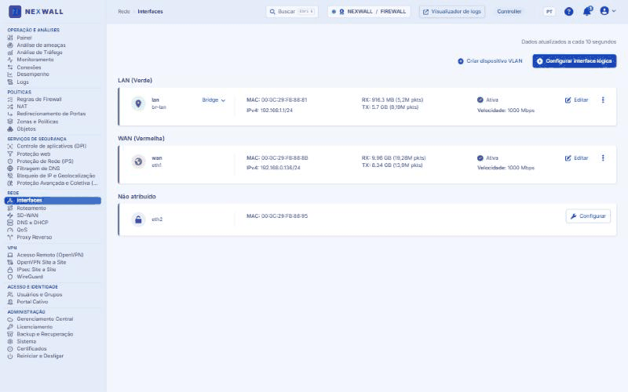

# Como configurar uma interface de rede (WAN, LAN, VLAN)

A página lista cada porta com sua zona, endereço MAC, contadores de tráfego e velocidade do link. Portas sem uso aparecem em **Não atribuído**.

**Onde:** **Rede** > **Interfaces**

## Antes de começar

- Planeje a zona e o endereço da nova rede. Crie antes uma zona personalizada se necessário ([Como criar uma zona e definir sua política](../policy/zone.md)).
- Não altere a interface pela qual você acessa a interface web, ou perderá a sessão.

## Passos

1. Abra a página.

   

2. Em uma porta não atribuída clique em **Configurar**. Para criar um bridge ou usar um dispositivo existente, clique em **Configurar interface lógica**.
3. Digite o **Nome da interface** e escolha a **Zona** (**LAN (Verde)**, **WAN (Vermelha)**, **GUEST (Azul)**, **DMZ (Laranja)** ou **Personalizado**).
4. Escolha o **Protocolo**: **Estático**, cliente DHCP ou PPPoE (preencha **Usuário** e **Senha**).
5. Para endereço estático preencha **Endereço IPv4**, **Máscara de sub-rede IPv4** e, em uma WAN, o **Gateway IPv4**.
6. Salve com **Configurar interface**. Para uma VLAN clique em **Criar dispositivo VLAN**, escolha o **Dispositivo base**, o **ID da VLAN** (1 a 4094) e clique em **Criar dispositivo**; depois configure o novo dispositivo como acima.
7. Para adicionar um segundo endereço a uma porta use **Criar interface de alias** no menu ⋮ da linha.

## Confirme que funcionou

- A linha mostra **Ativa** com o novo endereço.
- Faça ping no novo gateway a partir de um cliente da rede ou use [KBA-14](../../help/kba-14-connectivity.md).

## Se não funcionar

- O link aparece como **Inativa**: verifique o cabo e a porta do switch; `ethtool eth2` no console.
- Clientes sem endereço: ative o DHCP na interface ([Como ativar e ajustar o servidor DHCP](dhcp-server.md)).
- Remova a configuração de uma porta com **Remover configuração** no menu ⋮.

## Guias relacionados

- [Como criar uma zona e definir sua política](../policy/zone.md)
- [Como ativar e ajustar o servidor DHCP](dhcp-server.md)
- [Como adicionar uma rota estática](route.md)
