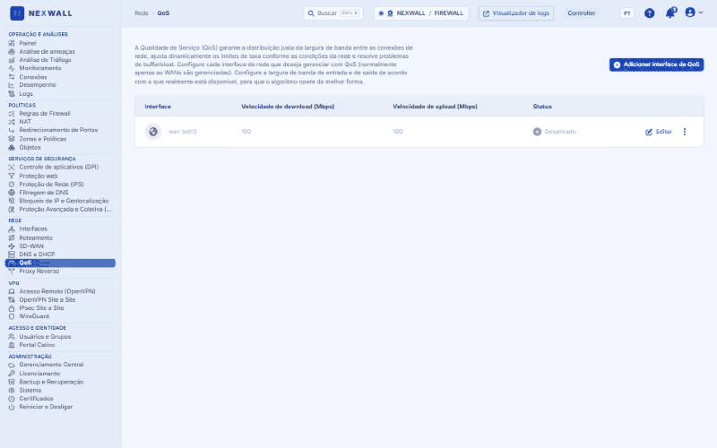

# Como limitar e dividir a banda (QoS)

O QoS mantém a latência baixa quando o link está cheio. Precisa da velocidade real do link.

**Onde:** **Rede** > **QoS**

## Antes de começar

- Meça a velocidade do link com o **teste de velocidade** do painel ou `speedtest` no console.

## Passos

1. Abra a página.

   

2. Clique em **Adicionar interface de QoS** (ou **Editar** na linha da WAN).
3. Escolha a **Interface** (normalmente a WAN) e informe a **Velocidade de download** e a **Velocidade de upload** em Mbps. Use cerca de 90 a 95 por cento da velocidade medida.
4. Ative o **Status** e salve.

## Confirme que funcionou

- A linha mostra o status **Ativado**. Faça um teste de velocidade enquanto baixa um arquivo grande: o ping permanece baixo.

## Se não funcionar

- Velocidade menor que a esperada: aumente os valores em passos pequenos.
- Link lento com fast-path ativo: veja [KBA-0018](../../help/kba-18-fast-path.md).

## Guias relacionados

- [Como usar dois links de internet (failover ou balanceamento)](sd-wan.md)
- [Como bloquear aplicativos e protocolos (Controle de aplicativos)](../security/app-control.md)
