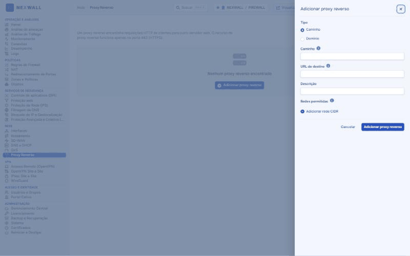

# Como publicar uma aplicação web com o proxy reverso

O proxy reverso escuta na porta TCP 443 do firewall e encaminha as requisições a servidores web internos, usando um certificado do firewall.

**Onde:** **Rede** > **Proxy Reverso**

## Antes de começar

- A porta TCP 443 deve estar acessível de onde os usuários vêm (uma regra ou o atalho **Ir para regras de firewall** da página).
- Se usar um domínio, um certificado confiável para ele ([Como instalar um certificado web confiável (Let's Encrypt ou importado)](../admin/certificate.md)).

## Passos

1. Abra a página e clique em **Adicionar proxy reverso**.

   

2. Escolha o **Tipo**: **Caminho** (por exemplo `/app`) ou **Domínio** (um nome de host).
3. Preencha a **URL de destino**, por exemplo `http://192.168.1.50:8080`, e uma **Descrição**.
4. Para limitar quem pode usar clique em **Adicionar rede CIDR** e informe as redes permitidas. Escolha o **Certificado** quando o tipo é domínio.
5. Clique em **Adicionar proxy reverso**.

## Confirme que funcionou

- Abra `https://<endereço-do-firewall>/app` de uma rede permitida e a aplicação carrega.

## Se não funcionar

- Timeout de fora: porta 443 não aberta, veja o aviso no topo da página.
- Aplicação com links absolutos não funciona sob um caminho: use um domínio.

## Guias relacionados

- [Como instalar um certificado web confiável (Let's Encrypt ou importado)](../admin/certificate.md)
- [Como publicar um servidor interno (redirecionamento de portas)](../policy/port-forward.md)
