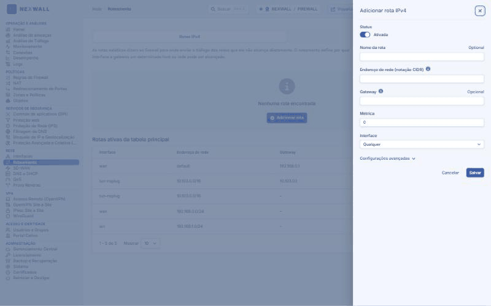

# Como adicionar uma rota estática

Use uma rota estática quando outro roteador conecta uma rede remota, por exemplo uma filial acessível por um roteador da LAN.

**Onde:** **Rede** > **Roteamento**

## Antes de começar

- Conheça a rede remota (CIDR) e o gateway em uma rede que o firewall já alcança.

## Passos

1. Abra a página e clique em **Adicionar rota** na aba **Rotas IPv4**.

   

2. Preencha **Nome da rota** (opcional) e **Endereço de rede (notação CIDR)**, por exemplo `10.20.0.0/24`.
3. Preencha o **Gateway** com o endereço do próximo roteador e escolha a **Interface** ou deixe em Qualquer.
4. Defina a **Métrica** se houver mais de uma rota para a mesma rede (a menor vence). Clique em **Salvar**.
5. Crie uma [Como permitir ou bloquear tráfego com uma regra de firewall](../policy/firewall-rule.md) se o tráfego cruza zonas.

## Confirme que funcionou

- A rota aparece em **Rotas ativas da tabela principal**.
- De um cliente da LAN, faça `ping` em um host da rede remota.

## Se não funcionar

- A rota não é usada: o gateway deve estar em uma rede diretamente conectada.
- As respostas não voltam: o host remoto precisa de uma rota de volta para a sua LAN.

## Guias relacionados

- [Como configurar uma interface de rede (WAN, LAN, VLAN)](interface.md)
- [Como permitir ou bloquear tráfego com uma regra de firewall](../policy/firewall-rule.md)
