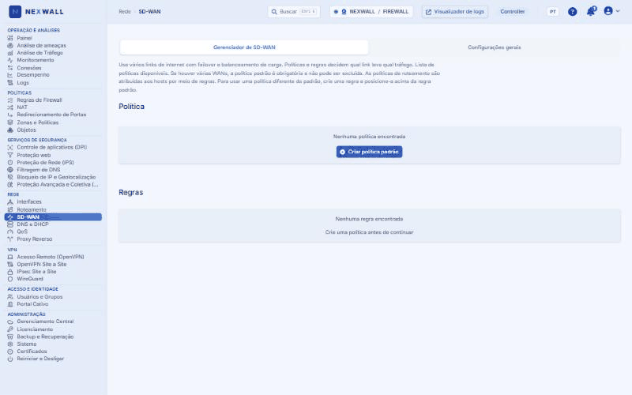

# Como usar dois links de internet (failover ou balanceamento)

Com dois ou mais links WAN o gerenciador SD-WAN decide qual link leva qual tráfego. A política padrão é obrigatória.

**Onde:** **Rede** > **SD-WAN**

## Antes de começar

- Ambas as portas WAN estão configuradas como interfaces da zona WAN ([Como configurar uma interface de rede (WAN, LAN, VLAN)](interface.md)).

## Passos

1. Abra a página.

   

2. Clique em **Criar política padrão**. Em **Escolher comportamento** escolha **Backup** (um link em uso, o outro espera) ou **Balanceamento** (ambos em uso).
3. Adicione cada gateway com **Adicionar gateway**. No modo backup ordene por prioridade; no balanceamento defina o **Peso** de cada um.
4. Abra a aba **Configurações gerais**. Em **Monitoramento de WAN** adicione endereços confiáveis para ping, por exemplo `1.1.1.1` e `8.8.8.8`. Ajuste **Configurações de ping** só se necessário.
5. Para enviar tráfego específico por um link específico clique em **Criar nova regra**: dê um nome, escolha a **Política atribuída** e a origem, destino, protocolo e portas. As regras são avaliadas em ordem; a política padrão fica por último.

## Confirme que funcionou

- A política mostra ambos os links ativos. Desconecte o principal: o tráfego muda dentro do tempo de detecção e o evento fica em **Logs**.

## Se não funcionar

- Os links oscilam: o endereço de monitoramento pode bloquear ping. Use dois endereços diferentes.
- Sessões caem no balanceamento: use **Sticky** na regra para sites que atrelam a sessão ao endereço de origem.

## Guias relacionados

- [Como configurar uma interface de rede (WAN, LAN, VLAN)](interface.md)
- [Como ler o painel](../monitor/dashboard.md)
