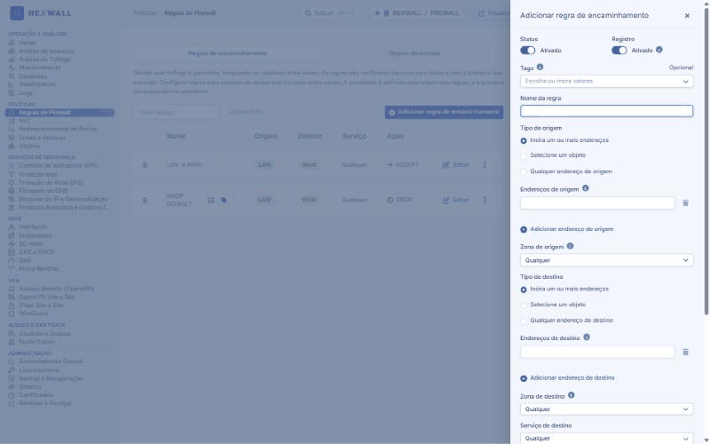

# Como permitir ou bloquear tráfego com uma regra de firewall

As regras de firewall decidem qual tráfego é aceito, descartado ou rejeitado. São avaliadas de cima para baixo e vale a primeira que coincidir, por isso a posição importa.

**Onde:** **Políticas** > **Regras de Firewall**

## Antes de começar

- Conheça a **zona de origem** e a **zona de destino** do tráfego (veja [Como criar uma zona e definir sua política](zone.md)).
- Decida a ação: **Aceitar** deixa passar, **Descartar** elimina em silêncio, **Rejeitar** elimina e avisa o remetente.

## Passos

1. Abra a página e escolha a aba: **Regras de encaminhamento** (tráfego entre zonas), **Regras de entrada** (tráfego para o próprio firewall) ou **Regras de saída** (tráfego que o firewall inicia).
2. Clique em **Adicionar regra de encaminhamento** (ou no botão de entrada/saída da aba). Um painel abre à direita.

   

3. Digite um **Nome da regra** que diga o que a regra faz, por exemplo `LAN para servidores HTTPS`.
4. Em **Tipo de origem** insira os endereços, escolha um objeto ou selecione **Qualquer endereço de origem**. Selecione a **Zona de origem**.
5. Faça o mesmo para o destino: **Tipo de destino** e **Zona de destino**.
6. Escolha o **Serviço**. Com **Serviço personalizado** informe **Protocolos** e **Portas**, por exemplo `8081, 9090, 5500-5600`.
7. Escolha a **Ação**.
8. Defina a **Posição da regra**: **Adicionar ao início** ou **Adicionar ao final**. Uma regra específica que deve vencer uma geral fica acima dela.
9. Deixe **Registro** ligado nas regras que quiser auditar. Clique em **Salvar regra**.
10. Para mudar a ordem depois, arraste a alça à esquerda da linha. Use o menu ⋮ para **Duplicar** ou **Excluir regra** uma regra.

## Confirme que funcionou

- A regra aparece na lista e o painel **Regras em resumo** a conta.
- Teste a partir de um cliente da zona de origem. O log da regra (**Logs**) mostra a ocorrência quando o registro está ligado.

## Se não funcionar

- A regra aparece como **Inativa**: usa uma zona que não existe mais ou está desativada. Edite e escolha uma zona válida.
- O tráfego continua bloqueado: uma regra acima coincide primeiro. Mova a sua para cima.
- Site inacessível a partir de um cliente: [KBA-04](../../help/kba-04-site-unreachable.md).

## Guias relacionados

- [Como criar uma zona e definir sua política](zone.md)
- [Como criar objetos reutilizáveis (conjuntos de hosts e de domínios)](object.md)
- [Como publicar um servidor interno (redirecionamento de portas)](port-forward.md)
