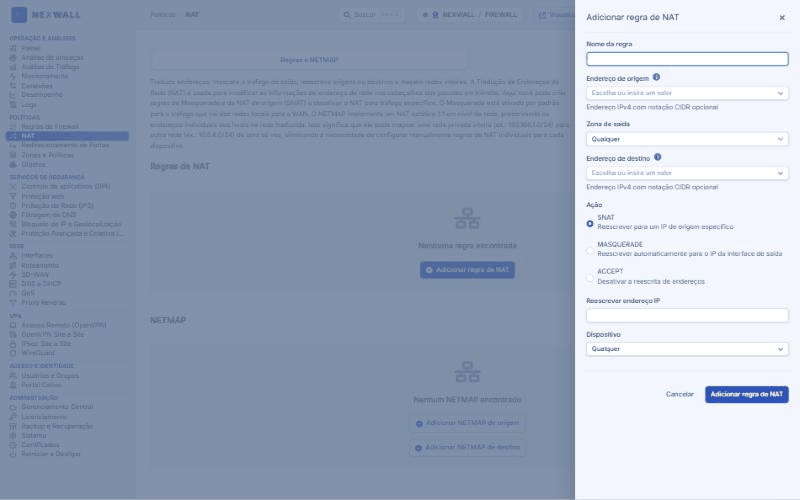

# Como criar uma regra de NAT (mascaramento ou NAT de origem)

O mascaramento já está ativo para a LAN. Crie uma regra de NAT quando precisar de um endereço de origem fixo, um diferente por rede ou nenhuma tradução (por exemplo entre dois sites por um túnel).

**Onde:** **Políticas** > **NAT**

## Antes de começar

- Conheça a rede de origem, a zona de saída e, para NAT de origem, o endereço público a usar.

## Passos

1. Abra a página e clique em **Adicionar regra de NAT**.

   

2. Digite o **Nome da regra**.
3. Preencha **Endereço de origem** e **Endereço de destino** (IPv4 com CIDR opcional) ou deixe **Qualquer endereço**. Escolha a **Zona de saída**.
4. Escolha a **Ação**: **Reescrever automaticamente para o IP da interface de saída**; **Reescrever para um IP de origem específico** (depois informe o **Reescrever endereço IP**); ou **Desativar a reescrita de endereços**.
5. Clique em **Salvar regra de NAT**.

## Confirme que funcionou

- A regra aparece na lista. No console, `nft list ruleset | grep -i snat` ou a lista de conexões (**Conexões**) mostra a origem traduzida.

## Se não funcionar

- O tráfego entre sites não deve ser traduzido: adicione uma regra **Desativar a reescrita de endereços** acima do mascaramento.
- Mesmos endereços nos dois sites: use NETMAP (aba **Regras e NETMAP**).

## Guias relacionados

- [Como permitir ou bloquear tráfego com uma regra de firewall](firewall-rule.md)
- [Como criar um túnel IPsec com outro firewall ou roteador](../vpn/ipsec-site-to-site.md)
