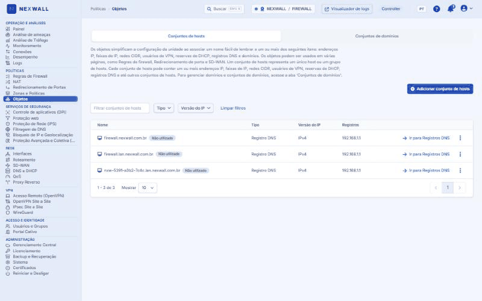

# Como criar objetos reutilizáveis (conjuntos de hosts e de domínios)

Objetos deixam as regras legíveis e fáceis de manter: altere o objeto e todas as regras que o usam o acompanham.

**Onde:** **Políticas** > **Objetos**

## Passos

1. Abra a página. Escolha a aba **Conjuntos de hosts** ou **Conjuntos de domínios**.

   

2. Clique em **Adicionar conjunto de hosts** (ou **Adicionar conjunto de domínios**). Digite um **Nome** só com letras e números.
3. Em um conjunto de hosts escolha a **Versão do IP** e clique em **Adicionar registro** para cada item: **Host**, **Rede CIDR**, **Faixa de IP**, **Reserva de DHCP** ou **Registro DNS**. Em um conjunto de domínios use **Adicionar domínio**.
4. Clique em **Salvar conjunto de hosts** (ou **Salvar conjunto de domínios**).
5. Use o objeto em uma regra: na origem ou destino escolha **Selecione um objeto**.

## Confirme que funcionou

- O objeto aparece na lista. **Mostrar usos** mostra onde é usado.

## Se não funcionar

- Não é possível excluir: o objeto está em uso. Remova-o antes das regras listadas nos usos.
- Redirecionamentos de porta não aceitam intervalos de IP nem objetos aninhados.

## Guias relacionados

- [Como permitir ou bloquear tráfego com uma regra de firewall](firewall-rule.md)
- [Como publicar um servidor interno (redirecionamento de portas)](port-forward.md)
