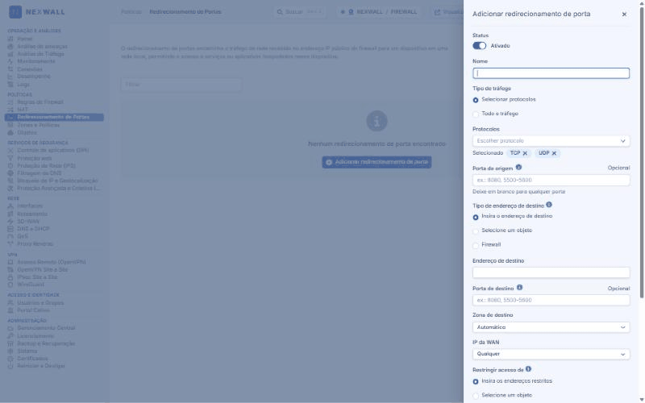

# Como publicar um servidor interno (redirecionamento de portas)

Um redirecionamento de portas publica um serviço, como um servidor web, que roda em um host interno, usando o endereço público do firewall.

**Onde:** **Políticas** > **Redirecionamento de Portas**

## Antes de começar

- O servidor interno tem endereço fixo (use uma reserva DHCP, veja [Como reservar um endereço IP fixo para um dispositivo](../network/dhcp-reservation.md)).
- Conheça a porta que os clientes usarão e a porta do servidor.

## Passos

1. Abra a página e clique em **Adicionar redirecionamento de porta**. Um painel abre.

   

2. Digite um **Nome**, por exemplo `Servidor web`.
3. Em **Tipo de tráfego** mantenha **Selecionar protocolos** e marque TCP, UDP ou ambos em **Protocolos**. Evite **Todo o tráfego**: envia tudo para um único host.
4. Informe a **Porta de origem** à qual os clientes se conectam, por exemplo `8080` ou `5500-5600`.
5. Em **Tipo de endereço de destino** informe o endereço do host interno ou escolha um objeto. Opcionalmente defina a **Porta de destino**; se vazia, a mesma porta é usada.
6. Escolha a **Zona de destino** (**Automático** serve na maioria dos casos) e o **IP da WAN** se tiver mais de um.
7. Para permitir só alguns clientes, preencha **Restringir acesso de** com endereços ou redes. Por padrão qualquer um pode conectar.
8. Ative as zonas de **Hairpin NAT** se usuários internos precisam acessar o serviço pelo nome público. Clique em **Salvar redirecionamento de porta**.

## Confirme que funcionou

- A linha mostra **Ativado**.
- Da internet, conecte ao endereço público e à porta. Teste de uma rede móvel, não de dentro da LAN.

## Se não funcionar

- Funciona de fora mas não da LAN: ative **Hairpin NAT** para a zona LAN.
- Sem resposta: o firewall do servidor ou seu gateway. O servidor deve usar o firewall como gateway padrão.
- Verifique o caminho com [KBA-0014](../../help/kba-14-connectivity.md).

## Guias relacionados

- [Como permitir ou bloquear tráfego com uma regra de firewall](firewall-rule.md)
- [Como criar objetos reutilizáveis (conjuntos de hosts e de domínios)](object.md)
