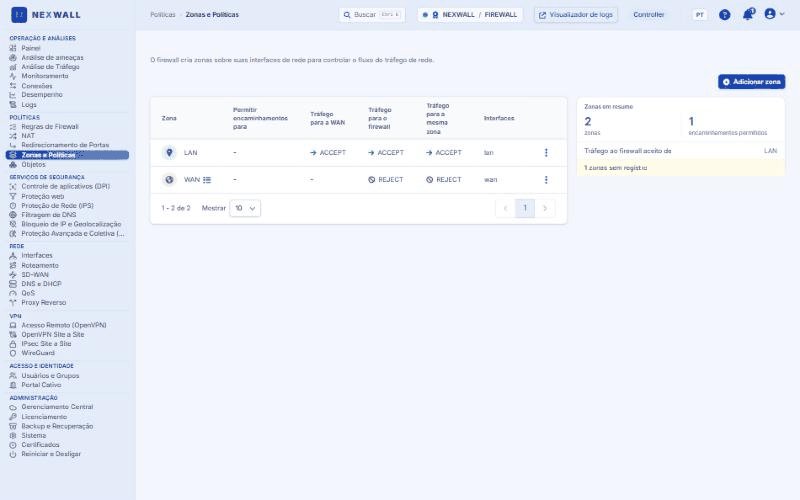

# Como criar uma zona e definir sua política

Uma zona é um grupo de interfaces de rede com o mesmo nível de confiança (LAN, WAN, Convidados, DMZ). A política de zona diz quais zonas podem enviar tráfego para quais.

**Onde:** **Políticas** > **Zonas e Políticas**

## Antes de começar

- A interface da nova rede existe (veja [Como configurar uma interface de rede (WAN, LAN, VLAN)](../network/interface.md)).

## Passos

1. Abra a página. A matriz mostra cada zona com **Permitir encaminhamentos para**, **Tráfego para a WAN**, **Tráfego para o firewall** e **Tráfego para a mesma zona**.

   

2. Clique em **Adicionar zona**. Escolha um modelo (**Convidado** ou **DMZ**) para ter uma política inicial segura, ou digite um **Nome**.
3. Selecione as **Interfaces** que pertencem à zona.
4. Em **Permitir encaminhamentos para** escolha as zonas que ela pode alcançar. Permita **Tráfego para o firewall** só para zonas que precisam da interface web, DNS ou DHCP do firewall.
5. Mantenha **Registro** ligado e salve.

## Confirme que funcionou

- A zona aparece com sua cor e o painel **Zonas em resumo** a conta.
- Um cliente da zona recebe endereço e só alcança o que foi permitido.

## Se não funcionar

- Convidados alcançam a LAN: remova a LAN de **Permitir encaminhamentos para** na zona Convidados.
- Para uma exceção, use uma [Como permitir ou bloquear tráfego com uma regra de firewall](firewall-rule.md) em vez de abrir toda a zona.

## Guias relacionados

- [Como permitir ou bloquear tráfego com uma regra de firewall](firewall-rule.md)
- [Como configurar uma interface de rede (WAN, LAN, VLAN)](../network/interface.md)
