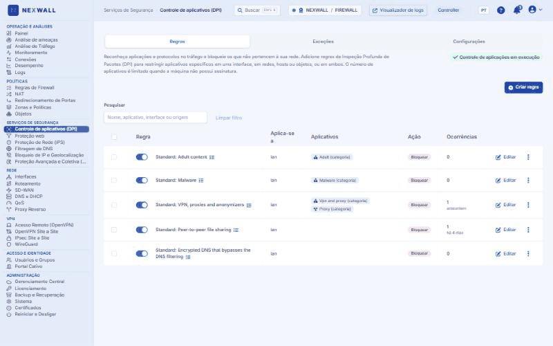

# Como bloquear aplicativos e protocolos (Controle de aplicativos)

O controle de aplicativos identifica aplicações por inspeção profunda de pacotes (DPI) e bloqueia as que você escolher, mesmo que usem portas comuns.

**Onde:** **Serviços de Segurança** > **Controle de aplicativos (DPI)**

## Antes de começar

- Uma assinatura ativa para o catálogo completo de aplicativos (a página marca os itens como **Disponível com assinatura**).
- Conheça a interface ou rede à qual a regra se aplica.

## Passos

1. Abra a página. Na aba **Regras** clique em **Criar regra**.

   

2. Escolha a **Interface** (**Qualquer interface** ou uma) e, em **Aplica-se a**, adicione as redes, hosts ou objetos. Vazio significa **Todos os hosts da interface**.
3. Em **Aplicativos e protocolos a bloquear** pesquise por nome ou categoria e selecione cada app ou protocolo a bloquear. O contador mostra quantos estão selecionados.
4. Ative **Ativar regra** e clique em **Salvar regra**.
5. Para que um host ignore as regras abra a aba **Exceções**, clique em **Adicionar exceção**, informe o **Nome da exceção** e o **Endereço IP**.

## Confirme que funcionou

- A regra mostra **Aplicativos e protocolos bloqueados**. Teste o app em um cliente: falha. As conexões bloqueadas aparecem em **Logs** e **Análise de ameaças**.

## Se não funcionar

- Um app não é bloqueado: pode usar uma versão nova criptografada. Atualize o catálogo (**Configurações**) e veja [KBA-0022](../../help/kba-22-unknown-applications.md).
- Lentidão indesejada: [KBA-0019](../../help/kba-19-inspection-settings.md) e [KBA-0021](../../help/kba-21-dpi-engine-stall.md).

## Guias relacionados

- [Como filtrar sites por categoria (Proteção web)](web-protection.md)
- [Como ativar a prevenção de intrusões (IPS)](ips.md)
