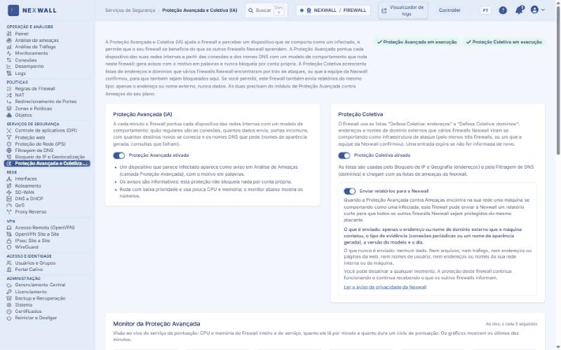

# Como ativar a Proteção Avançada e Coletiva

A proteção avançada (IA) avisa sobre dispositivos que se comportam como infectados. A proteção coletiva adiciona listas de endereços e domínios aprendidas de outros firewalls Nexwall.

**Onde:** **Serviços de Segurança** > **Proteção Avançada e Coletiva (IA)**

## Antes de começar

- Um plano que inclua o módulo Advanced Threat Protection (veja [Como registrar a licença e verificar a assinatura](../admin/licensing.md)).

## Passos

1. Abra a página.

   

2. Em **Proteção Avançada (IA)** ative **Proteção Avançada ativada**. A proteção só avisa em **Análise de ameaças**; não bloqueia nada sozinha.
3. Em **Proteção Coletiva** ative **Proteção Coletiva ativada**. As listas compartilhadas são usadas por Bloqueio de IP e Filtragem de DNS, então ambos devem estar ativos ([Como bloquear endereços IP e países maliciosos (Bloqueio de IP e Geolocalização)](ip-geo-blocking.md), [Como bloquear domínios maliciosos (Filtragem de DNS)](dns-filtering.md)).
4. Decida sobre **Enviar relatórios para a Nexwall**. Só o endereço ou nome de domínio externo é enviado; nenhum arquivo, tráfego ou dado de usuário.
5. Salve e aplique. O **Monitor da Proteção Avançada** mostra a CPU e memória do serviço e os alertas gerados.

## Confirme que funcionou

- O monitor mostra o ciclo de pontuação em execução e o número de dispositivos acompanhados.

## Se não funcionar

- "Não incluído no seu plano": verifique **Licenciamento**.
- Serviço parado: reinicie pelo console e veja [KBA-0016](../../help/kba-16-services.md).

## Guias relacionados

- [Como bloquear endereços IP e países maliciosos (Bloqueio de IP e Geolocalização)](ip-geo-blocking.md)
- [Como revisar as ameaças bloqueadas e os dispositivos em risco](../monitor/threat-analytics.md)
