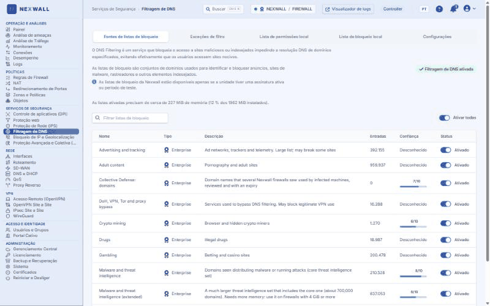

# Como bloquear domínios maliciosos (Filtragem de DNS)

A filtragem de DNS impede que os clientes resolvam domínios maliciosos conhecidos usando listas de bloqueio atualizadas automaticamente.

**Onde:** **Serviços de Segurança** > **Filtragem de DNS**

## Antes de começar

- Os clientes usam o firewall como servidor DNS ([Como ativar e ajustar o servidor DHCP](../network/dhcp-server.md)).

## Passos

1. Abra a página e escolha a aba **Configurações**.

   

2. Ative **Filtragem de DNS ativada**. Escolha as **Forçar redirecionamento de DNS nestas zonas** em que as requisições DNS devem ser redirecionadas ao firewall, mesmo que o cliente tenha DNS próprio.
3. Na aba **Fontes de listas de bloqueio** ative as listas desejadas. Observe o aviso de memória: listas grandes precisam dela.
4. Para bloquear mais um domínio abra **Lista de bloqueio local** e clique em **Adicionar domínio**. Para sempre permitir um domínio use **Lista de permissões local**.
5. Para isentar um cliente use **Exceções de filtro** e **Adicionar exceção**.

## Confirme que funcionou

- `nslookup` de um domínio bloqueado não retorna o endereço real. Os bloqueios aparecem em **Análise de ameaças**.

## Se não funcionar

- Um site bom está bloqueado: adicione o domínio à lista local de permitidos.
- As listas não carregam: [KBA-0023](../../help/kba-23-threat-shield-troubleshooting.md) e [KBA-0024](../../help/kba-24-threat-shield-lists.md).

## Guias relacionados

- [Como bloquear endereços IP e países maliciosos (Bloqueio de IP e Geolocalização)](ip-geo-blocking.md)
- [Como definir servidores DNS e nomes DNS locais](../network/dns-record.md)
