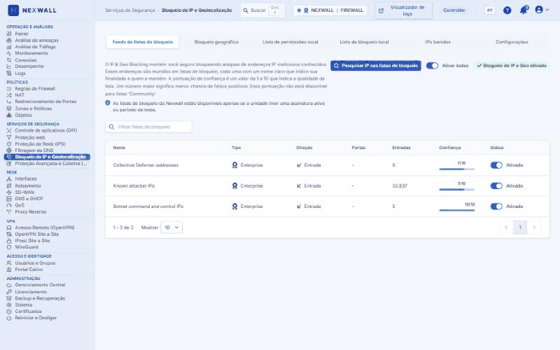

# Como bloquear endereços IP e países maliciosos (Bloqueio de IP e Geolocalização)

O bloqueio de IP e geolocalização descarta o tráfego de e para endereços com má reputação, por lista ou por país, antes que chegue às suas regras.

**Onde:** **Serviços de Segurança** > **Bloqueio de IP e Geolocalização**

## Passos

1. Abra a página e escolha a aba **Configurações**.

   

2. Ative **Bloqueio de IP e Geo ativado**. Defina as opções: **Registro** de pacotes bloqueados e **Bloquear ataques de força bruta**.
3. Na aba **Feeds de listas de bloqueio** ative as listas desejadas. Cada lista mostra sua **Direção** e **Confiança**.
4. Para impedir que países inteiros alcancem o próprio firewall abra a aba **Bloqueio geográfico** e marque os **Países bloqueados**. Endereços banidos (força bruta) aparecem em **IPs banidos**.
5. Para bloquear um endereço abra **Lista de bloqueio local** e clique em **Adicionar endereço**. Para proteger o endereço de um parceiro use **Lista de permissões local**.
6. Salve e aplique.

## Confirme que funcionou

- Os pacotes bloqueados são contados e, com o registro ligado, gravados no log.

## Se não funcionar

- Um parceiro não consegue conectar: adicione o endereço à lista local de permitidos.
- As listas não atualizam: [KBA-24](../../help/kba-24-threat-shield-lists.md).

## Guias relacionados

- [Como bloquear domínios maliciosos (Filtragem de DNS)](dns-filtering.md)
- [Como permitir ou bloquear tráfego com uma regra de firewall](../policy/firewall-rule.md)
