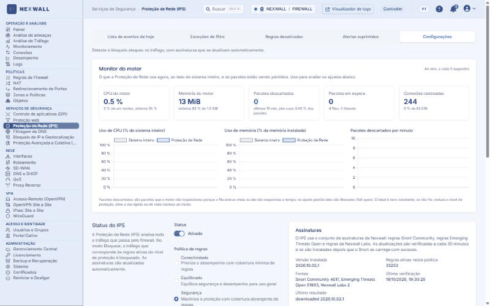

# Como ativar a prevenção de intrusões (IPS)

O IPS inspeciona o tráfego em busca de ataques. Comece com a política equilibrada e aumente só se precisar.

**Onde:** **Serviços de Segurança** > **Proteção de Rede (IPS)**

## Antes de começar

- Uma assinatura ativa (a página avisa se a licença faltar).
- Memória suficiente: veja [KBA-20](../../help/kba-20-throughput-sizing.md).

## Passos

1. Abra a página e escolha a aba **Configurações**.

   

2. Ative **IPS ativado**. Se a página mostrar **O IPS está desativado**, use **Ir para Configurações**.
3. Escolha a **Política de regras**: **Conectividade** (menos falsos positivos), **Equilibrado** (recomendada) ou **Segurança** (a mais rígida).
4. Confira se as assinaturas estão atualizadas em **Assinaturas**; clique em **Verificar atualizações agora** se necessário.
5. Salve e aplique. Para um endereço confiável que gera falsos alarmes abra a aba **Exceções de filtro** e clique em **Adicionar exceção**.

## Confirme que funcionou

- A aba **Lista de eventos de hoje** lista os eventos do dia. O status do IPS indica que está rodando.

## Se não funcionar

- O desempenho caiu: [KBA-19](../../help/kba-19-inspection-settings.md) e [KBA-20](../../help/kba-20-throughput-sizing.md).
- Um serviço legítimo bloqueado: ache a regra na lista de eventos e use **Regras desativadas** ou o bypass.

## Guias relacionados

- [Como bloquear aplicativos e protocolos (Controle de aplicativos)](app-control.md)
- [Como revisar as ameaças bloqueadas e os dispositivos em risco](../monitor/threat-analytics.md)
