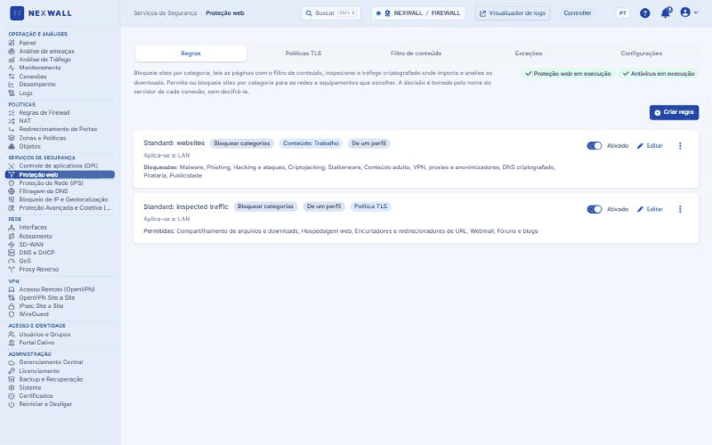

# Como filtrar sites por categoria (Proteção web)

A proteção web filtra HTTP e HTTPS por categoria. Com inspeção SSL as categorias se aplicam a páginas criptografadas; sem ela só o nome do host é usado.

**Onde:** **Serviços de Segurança** > **Proteção web**

## Antes de começar

- Uma assinatura que inclua Proteção web.
- Para filtragem HTTPS completa, o certificado do firewall instalado nos clientes ([Como instalar um certificado web confiável (Let's Encrypt ou importado)](../admin/certificate.md)).

## Passos

1. Abra a página e, na aba **Configurações**, ative **Ativar a proteção web** se estiver desligado.

   

2. Vá à aba **Regras** e clique em **Criar regra**.
3. Digite o **Nome da regra** e escolha as **Zonas** e, opcionalmente, as **Redes, equipamentos e objetos** (redes, hosts e objetos).
4. Escolha o modo: **Bloquear categorias** (bloqueia as categorias marcadas) ou **Lista de permitidos** (só as categorias marcadas são permitidas).
5. Marque cada categoria como **Permitidas** ou **Bloqueadas**. Use **Buscar categorias** para encontrá-las. Escolha a **Política TLS** e ative **Ativar a regra**. Salve.
6. Para isentar um host ou site use a aba **Exceções**.

## Confirme que funcionou

- Uma categoria bloqueada mostra a página de bloqueio no navegador.
- A regra aparece na lista; o catálogo de categorias está atualizado em **Listas de categorias**.

## Se não funcionar

- Aviso de certificado em sites HTTPS: instale a CA do firewall no cliente ou isente o site.
- Um site está mal categorizado: adicione uma exceção e informe à Nexwall.

## Guias relacionados

- [Como bloquear domínios maliciosos (Filtragem de DNS)](dns-filtering.md)
- [Como bloquear aplicativos e protocolos (Controle de aplicativos)](app-control.md)
