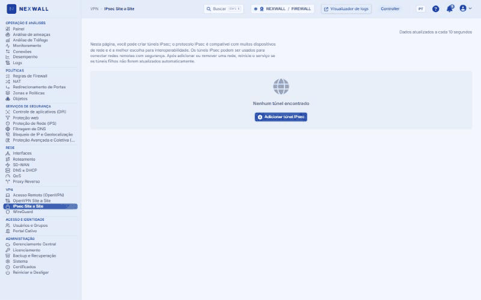

# Como criar um túnel IPsec com outro firewall ou roteador

IPsec (IKEv2) é a escolha padrão para conectar a um roteador ou firewall de outra marca.

**Onde:** **VPN** > **IPsec Site a Site**

## Antes de começar

- O endereço público da outra ponta e seu identificador (se houver).
- As redes remota e local, que não devem se sobrepor, e a mesma chave pré-compartilhada e parâmetros de criptografia nas duas pontas.

## Passos

1. Abra a página e clique em **Adicionar túnel IPsec**.

   

2. Digite o **Nome do túnel**. Escolha a WAN com **Escolher WAN** e informe o **Endereço IP remoto**.
3. Adicione as **Redes locais** e **Redes remotas** com **Adicionar rede**.
4. Em **Chave pré-compartilhada** use **Usar chave gerada** (copie para a outra ponta) ou **Usar chave personalizada**. Defina o identificador local e remoto só se o outro lado exigir.
5. Abra **Fase 1 (IKE)** e a seção da fase 2 e iguale os algoritmos, tempos de vida e DPD da outra ponta. Salve.
6. Crie as regras de firewall entre as zonas LAN e VPN ([Como permitir ou bloquear tráfego com uma regra de firewall](../policy/firewall-rule.md)) e isente do NAT o tráfego do túnel ([Como criar uma regra de NAT (mascaramento ou NAT de origem)](../policy/nat-rule.md)).

## Confirme que funcionou

- A linha do túnel mostra **Conectado**, com o child SA **Instalado**. No console, `swanctl --list-sas` mostra ESTABLISHED.

## Se não funcionar

- Nunca sai do estado conectando: chave, identificadores ou propostas incorretos. Compare as duas pontas e veja o log: `grep charon /var/log/messages`.
- Ativo sem tráfego: regras, NAT ou rotas. Veja [KBA-06](../../help/kba-06-vpn.md).

## Guias relacionados

- [Como conectar dois escritórios com OpenVPN (site a site)](openvpn-site-to-site.md)
- [Como criar uma regra de NAT (mascaramento ou NAT de origem)](../policy/nat-rule.md)
