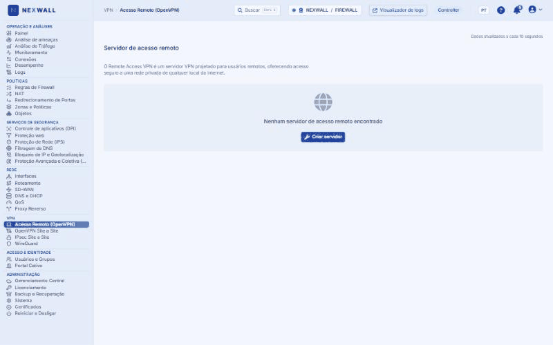

# Como permitir que usuários conectem de casa (acesso remoto OpenVPN)

O acesso remoto (OpenVPN) permite que notebooks e celulares conectem com segurança às suas redes de qualquer lugar.

**Onde:** **VPN** > **Acesso Remoto (OpenVPN)**

## Antes de começar

- O endereço WAN do firewall ou um nome DNS que aponte para ele ([Como instalar um certificado web confiável (Let's Encrypt ou importado)](../admin/certificate.md) se quiser um certificado web confiável).
- Os usuários existem na base local ou em um diretório ([Como criar usuários e conectar um diretório (LDAP / Active Directory)](../access/user.md)).
- Um endereço WAN acessível pela internet: a porta da VPN (UDP 1194 por padrão) deve chegar ao firewall.

## Passos

1. Abra a página e clique em **Criar servidor**.

   

2. Digite o **Nome do servidor**. Escolha a **Banco de dados de usuários** e o **Modo de autenticação** (**Usuário e senha**, **Certificado** ou com OTP).
3. Escolha o **Modo**: **Roteado** (recomendado) com uma **Rede VPN** que não se sobreponha à sua LAN, por exemplo `10.8.0.0/24`.
4. Adicione o **IP público/nome de host desta unidade**. Mantenha o **Protocolo** **UDP** e a **Porta** padrão, a menos que uma rede bloqueie.
5. Escolha o que os clientes alcançam: **Enviar rotas de rede** (só as redes que você adicionar) ou **Rotear todo o tráfego dos clientes pela VPN**.
6. Clique em **Criar**. Depois abra a aba **Contas de acesso remoto**, crie as contas (ou **Criar uma conta para cada usuário**) e use **Baixar configuração** para cada usuário.
7. Entregue ao usuário o arquivo para importar em um cliente OpenVPN.

## Confirme que funcionou

- **Clientes conectados** lista o usuário após conectar. O usuário alcança um endereço interno.

## Se não funcionar

- O cliente não conecta: a porta não está aberta na WAN ou um roteador na frente bloqueia. Teste de fora da LAN.
- Conecta mas não alcança a LAN: adicione a rede em **Enviar rotas de rede** e crie uma [Como permitir ou bloquear tráfego com uma regra de firewall](../policy/firewall-rule.md) a partir da zona VPN.
- Veja [KBA-0006](../../help/kba-06-vpn.md).

## Guias relacionados

- [Como criar usuários e conectar um diretório (LDAP / Active Directory)](../access/user.md)
- [Como configurar o WireGuard (servidor com peers ou túnel de peer)](wireguard.md)
- [Como permitir ou bloquear tráfego com uma regra de firewall](../policy/firewall-rule.md)
