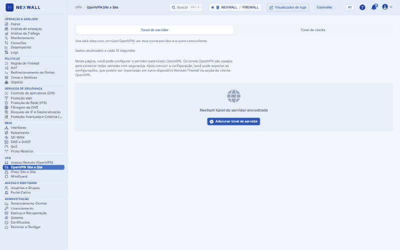

# Como conectar dois escritórios com OpenVPN (site a site)

Um firewall atua como servidor do túnel e o outro como cliente. O servidor exporta um pacote que o cliente importa.

**Onde:** **VPN** > **OpenVPN Site a Site**

## Antes de começar

- Um endereço público (ou nome) acessível no lado servidor.
- As redes local e remota não devem se sobrepor.

## Passos

1. No site servidor abra a página, aba **Túnel de servidor**, e clique em **Adicionar túnel de servidor**.

   

2. Digite o **Nome do túnel**. Adicione as **Redes locais** a compartilhar e as **Redes remotas** do outro site. Adicione os **Endpoints públicos** (endereço público ou nome).
3. Mantenha o **Protocolo** e a **Porta** padrão. Clique em **Salvar**.
4. Clique em **Baixar** na linha do túnel e escolha o arquivo de **Configuração de cliente \{product\}**.
5. No outro site abra a aba **Túnel de cliente**, clique em **Importar configuração** e escolha o arquivo. Salve.
6. Nos dois firewalls crie uma [Como permitir ou bloquear tráfego com uma regra de firewall](../policy/firewall-rule.md) entre a zona LAN e a zona VPN e garanta que o NAT não traduza o tráfego do túnel ([Como criar uma regra de NAT (mascaramento ou NAT de origem)](../policy/nat-rule.md)).

## Confirme que funcionou

- Os dois lados mostram a conexão como **Conectado**. Um host de uma LAN dá ping em um host da outra.

## Se não funcionar

- Não conectado: a porta UDP não está acessível no servidor. Teste de fora.
- Conectado, sem tráfego: falta regra de firewall, redes sobrepostas ou falta rota nos hosts.
- Veja [KBA-06](../../help/kba-06-vpn.md).

## Guias relacionados

- [Como criar um túnel IPsec com outro firewall ou roteador](ipsec-site-to-site.md)
- [Como configurar o WireGuard (servidor com peers ou túnel de peer)](wireguard.md)
