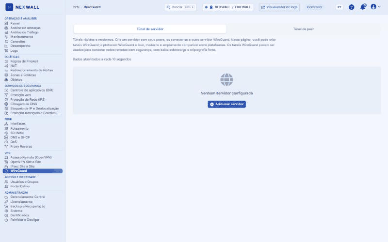

# Como configurar o WireGuard (servidor com peers ou túnel de peer)

O WireGuard é rápido e simples. Um túnel servidor atende muitos peers; um túnel de peer conecta este firewall a outro servidor WireGuard.

**Onde:** **VPN** > **WireGuard**

## Passos

1. Abra a página. Para usuários escolha a aba **Túnel de servidor** e clique em **Adicionar servidor**.

   

2. Digite o **Nome**, a **Rede VPN** (por exemplo `10.9.0.0/24`), a **Porta UDP** e o **Endpoint público** do firewall. Adicione as **Redes do servidor** que os peers podem alcançar e, se preciso, os **Servidores DNS**. Salve.
3. Na linha do servidor clique em **Adicionar peer**: digite o **Nome** do peer, escolha **Rotear todo o tráfego** se todo o tráfego deve ir pela VPN e salve.
4. Entregue ao peer a configuração: **Baixar configuração** ou **Baixar QR code** para escanear com o app do celular.
5. Para conectar este firewall a outro servidor WireGuard use a aba **Túnel de peer**: **Adicionar túnel de peer** ou **Importar túnel de peer** com um arquivo de configuração.
6. Crie as regras de firewall entre as zonas ([Como permitir ou bloquear tráfego com uma regra de firewall](../policy/firewall-rule.md)).

## Confirme que funcionou

- O peer mostra um handshake recente (**Conexão**). Do peer, dê ping em um endereço interno.

## Se não funcionar

- Sem handshake: a porta UDP não está acessível ou as chaves não coincidem.
- Handshake mas sem tráfego: regras ou as redes permitidas do peer.
- Veja [KBA-0006](../../help/kba-06-vpn.md).

## Guias relacionados

- [Como permitir que usuários conectem de casa (acesso remoto OpenVPN)](openvpn-remote-access.md)
- [Como permitir ou bloquear tráfego com uma regra de firewall](../policy/firewall-rule.md)
