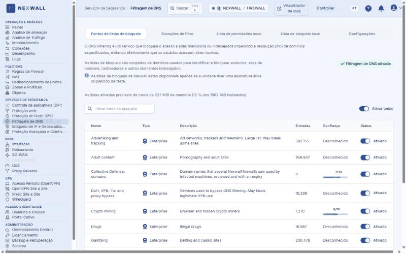

# Filtragem de DNS

**Serviços de Segurança > Filtragem de DNS** bloqueia sites impedindo a resolução de seus nomes. Quando um dispositivo
pede o endereço de um domínio bloqueado, a unidade não responde com um endereço utilizável, então o site não pode ser
acessado. É leve, funciona para todos os dispositivos da rede sem instalar nada e também bloqueia publicidade e
rastreadores.

*Filtragem de DNS: fontes de listas de bloqueio com categoria, entradas, confiança e status.*

**Nesta tela**

- Cada linha é uma lista de bloqueio por categoria. A chave à direita a liga; **Ativar todas** muda todas as listas.
- A **confiança** (1 a 10) mostra o quanto a lista é confiável; número maior significa menos falsos positivos.
- A nota no alto mostra a memória que as listas ativas precisam; confira antes de ligar listas grandes em máquinas pequenas.
- Outras abas: **Exceções de filtro**, **Lista de permissões local**, **Lista de bloqueio local** e **Configurações**.

## Listas de bloqueio

Uma **lista de bloqueio** é uma lista de domínios agrupados por finalidade e mantida por alguém. A página lista as fontes
disponíveis e permite habilitar as que você quiser. Elas cobrem categorias como malware e phishing, publicidade e
rastreadores, conteúdo adulto, jogos de azar, pirataria e serviços usados para contornar a filtragem. Algumas listas estão
disponíveis para todas as unidades; outras, apenas com uma assinatura que inclua as listas avançadas. A página informa qual é
qual.

As listas de bloqueio são atualizadas automaticamente.

## Ativando o filtro

1. Abra a aba **Configurações** e habilite a filtragem de DNS.
2. Escolha as **zonas** cujo tráfego é redirecionado para o filtro. Os dispositivos dessas zonas são filtrados mesmo que
   estejam configurados com outro servidor DNS.
3. Escolha as **portas** a redirecionar. O DNS normalmente usa a porta 53.
4. Em **Fontes de listas de bloqueio**, habilite as listas que você quer.
5. Salve e **Aplicar alterações**.

## Suas próprias listas

- **Lista de bloqueio local:** domínios que você quer bloquear além das listas.
- **Domínios permitidos:** domínios que nunca devem ser bloqueados, mesmo que uma lista os contenha. Remover um domínio
  dessa lista pode fazer com que ele volte a ser bloqueado se uma lista o incluir, e a página avisa.

## Exceções para alguns dispositivos

Use a aba **Bypass do filtro** para deixar de filtrar endereços ou sub-redes específicos, por exemplo uma rede de
gerenciamento ou um servidor que precisa de acesso sem filtro.

## Limites a ter em mente

- A filtragem de DNS não vê o conteúdo das páginas, ela apenas bloqueia nomes. Um dispositivo que se conecta diretamente
  a um endereço sem nome não é afetado. Combine-a com o [bloqueio de IP e geolocalização](ip-geo-blocking.md) e com o
  [controle de aplicações](application-control.md).
- O DNS criptografado usado por uma aplicação pode contornar um resolvedor que não seja a unidade. Redirecionar as portas
  de DNS da zona e habilitar as listas que bloqueiam serviços usados para contornar a filtragem reduz esse risco.

## Páginas relacionadas

- [DNS e DHCP](../network/dns-dhcp.md)
- [Objetos](../policy/objects.md)
